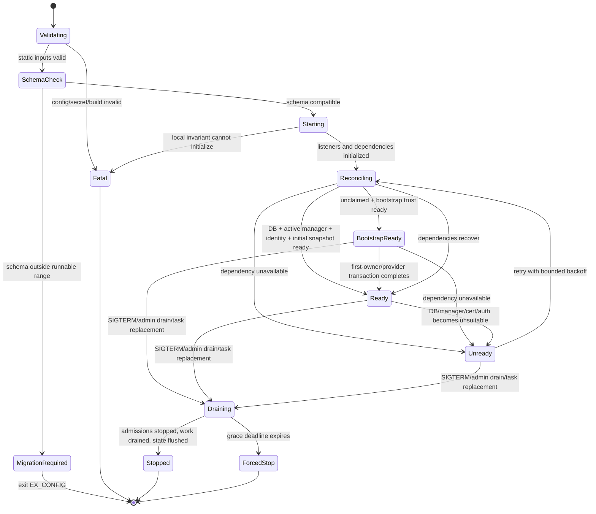
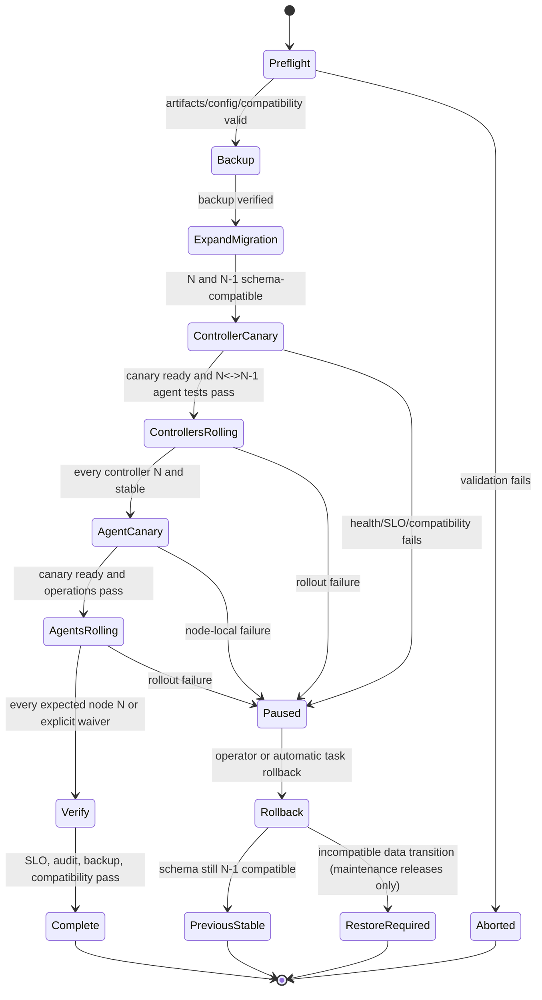

# Kontainer v2 agent installation and lifecycle

Status: proposed production architecture

Research date: 2026-08-19

Scope: packaging, installation, configuration, startup, health, scheduling, shutdown, upgrades, rollback, backup, disaster recovery, offline deployment, releases, and supportability for the Rust controller and node agent

## Executive decision

Kontainer v2 should ship **two Rust binaries and two minimal OCI images from one versioned Rust workspace and one coordinated release**:

- `kontainer-controller` runs only on Swarm manager nodes. It serves the public API, uses the manager-local Docker socket for Swarm-scoped operations, owns durable control state, and participates in scheduled-work leasing.
- `kontainer-node-agent` runs as a global service on every supported Swarm node, including managers. It owns node-local Docker and host operations and exposes only the internal mTLS gRPC API.

Production installation uses two Swarm services, an unexposed control overlay, immutable Docker configs, Docker secret files, digest-pinned images, and an external/shared transactional database for multiple controllers. A one-controller SQLite profile is retained for v1 parity and small non-HA installations, but it is explicitly not a failover design. This workload split and the internal identity model are defined in [cluster communication](./cluster-communication.md); this document makes their operational lifecycle concrete.

The release is operator-managed. The processes do not replace their own executables, update their own Swarm services, or silently pull a newer tag. Controllers are upgraded before node agents; both sides must interoperate across adjacent releases. Routine rollback uses the previous signed image digests and a schema-compatible deployment, not database restore. Restore is a disaster-recovery action.

The process lifecycle is fail-fast for invalid static configuration and missing secrets, fail-closed for incompatible schema/protocol/identity, and explicitly degraded for temporary dependencies. A running PID is not readiness. Startup, liveness, readiness, build/version, and deep authenticated diagnostics are separate surfaces. On `SIGTERM`, a process becomes unready, stops admission, cancels or drains owned work, flushes bounded durable state, and exits within the orchestrator grace period. Tokio's own shutdown guidance separates detecting shutdown, notifying tasks, and waiting for them; v2 should implement that ownership model with cancellation tokens and a tracked task set ([Tokio graceful shutdown](https://tokio.rs/tokio/topics/shutdown)).

The release pipeline must build and test `linux/amd64` and `linux/arm64`, publish per-component manifest lists to GHCR, publish standalone binaries for the later native-service profile, attach SBOM and maximum available provenance, attest every digest, and produce an offline bundle. GitHub documents the token permissions needed to publish to GHCR and generate attestations, while Docker's BuildKit integration can attach both SBOM and provenance to images ([GitHub container publishing](https://docs.github.com/en/packages/managing-github-packages-using-github-actions-workflows/publishing-and-installing-a-package-with-github-actions), [Docker build attestations](https://docs.docker.com/build/ci/github-actions/attestations/)). Production manifests always name an immutable digest even when a human-readable SemVer tag is also present.

## Goals and boundaries

This design must make the following ordinary and recoverable:

- first installation on a new single-manager or multi-manager Swarm;
- a node joining, leaving, being drained, being replaced, or losing its local agent state;
- controller or node-agent restart without corrupting state or fabricating health;
- safe schema evolution and v1 data import;
- controller-first rolling upgrade, canary, pause, rollback, and certificate rotation;
- manager, database, Docker daemon, disk, network, certificate, and process failures;
- verified delivery through GHCR or a disconnected private registry;
- evidence collection that is useful without exporting credentials or customer workload data.

It does not define public API authorization, the detailed mTLS enrollment protocol, the stack reconciler, metrics schema, logging protocol, or exec framing. Those are authoritative in [security](./security.md), [cluster communication](./cluster-communication.md), [stack deployment](./stack-deployment.md), [metrics storage](./metrics-storage.md), [logging](./logging.md), and [exec](./exec.md). Lifecycle policy must satisfy all of them.

Docker socket access remains root-equivalent authority even when the process UID is non-root. Packaging can reduce ambient OS privileges and accidental file access, but it cannot turn unrestricted socket access into a sandbox. V2 exposes a Kontainer domain API and never a generic Docker proxy.

## What v1 actually ships

The current Go/Goravel server is useful evidence, not a deployable v2 baseline.

### Startup and role behavior

- [`server/main.go`](../../server/main.go) constructs the Goravel application and calls `app.Start()`. There is no application-owned startup state machine, signal coordinator, drain phase, shutdown deadline, or exit-code contract in the repository.
- [`server/bootstrap/app.go`](../../server/bootstrap/app.go) registers migrations, all providers, all route groups, gRPC interceptors, middleware, and schedules for every process. Individual routes and schedules check `cluster.role`; providers generally do not.
- [`server/config/cluster.go`](../../server/config/cluster.go) accepts `AGENT_ROLE=leader|follower`, silently converting any invalid value to `leader`. A typo can therefore expose the public role instead of stopping safely.
- Leaders register auth, setup, `/api/*`, WebSocket, health, ping, gRPC, discovery, collection, and pruning. Followers still boot HTTP health/ping and gRPC, but also boot database/auth providers that query leader-only data. Role is a string condition, not a packaging or capability boundary.
- The current leader schedule discovers followers every ten seconds in production, collects metrics every minute, and prunes every five minutes. Jobs use `context.Background()`. `SkipIfStillRunning` prevents overlap, but there is no cancellation tree, startup jitter, durable occurrence claim, or takeover fencing. `METRICS_INTERVAL` is ignored, and the retention provider reads a different key than configuration registers.
- The gRPC connection pool has `CloseAll`, and the auth session store has `Close`, but there is no lifecycle owner that invokes them. The older pre-Goravel agent did have explicit `SIGINT`/`SIGTERM` shutdown; commit `6aa69c0` added it specifically so deferred cleanup would run. That behavior was lost during replacement rather than superseded by an application-level equivalent.

### Configuration and secrets

V1 reads a broad set of environment variables through framework configuration. `docs/deployment.md` says `CLUSTER_SECRET_FILE`, `JWT_SECRET_FILE`, and `DB_DATABASE_FILE` are resolved at startup, but current code does not do that. Commit `5d3cae1` added a tested `_FILE` resolver; commit `571b0e4` removed it with the intention that deployment would resolve secrets instead. The deployment examples were not updated, so the documented secret contract is false.

Configuration has several unsafe or ambiguous defaults:

- invalid role becomes `leader`;
- HTTP defaults to loopback while the container example publishes the port;
- `GRPC_PORT` has no default in code although deployment docs say `9000`;
- `AGENT_URL`, `APP_URL`, bind addresses, and advertised addresses overlap conceptually;
- arbitrary `settings` and `app_configs` rows mix dynamic product data with secrets;
- missing cluster secret does not prevent process startup even though internal RPC then cannot authenticate;
- generated setup state and OAuth/JWT material depend on the local SQLite file surviving task replacement.

The v1 setup endpoints and token behavior have security defects documented in [security](./security.md): the complete generated token is logged, some public setup routes do not validate it, setup state is process-local, and setup completion remains callable after claim. Lifecycle must not expose “healthy” while the controller is unclaimed or only partially initialized.

### Health, migrations, storage, and shutdown

- `GET /health` always returns `{"status":"ok"}` without checking startup, Docker, database, certificate, role, or shutdown state.
- `GET /ping` always returns HTTP 200 and queries SQLite only to choose `ok` or `setup_required`. It has no build version, protocol range, schema version, uptime, or dependency status. Followers make the same leader-oriented setup query.
- The gRPC `Health` method always returns `ok` with node ID and hostname after the controller has been constructed. It does not express capability readiness.
- Migrations are registered but executed only through the Artisan migration command. Neither the image entrypoint nor `docker-compose.yml` runs or gates on them. Application providers can query tables during boot before an operator has migrated.
- Migration `20260320000000_create_metrics_table` drops `node_metrics` before creating `metrics`; its rollback drops `metrics` without restoring the old table. There is no backup, expand/backfill/verify/contract sequence, supported schema range, migration lock, or restore rehearsal.
- SQLite defaults to `storage/kontainer.db`, while the runtime Dockerfile does not create or copy the storage tree or mount it. The documented production command supplies `/data`, but the checked-in Compose file supplies neither storage nor Docker access.
- No repository-owned code coordinates `SIGTERM` with HTTP admission, WebSockets, gRPC, schedules, Docker streams, database writes, or pool closure. Framework behavior alone cannot know the domain drain order.

### Image and release gaps

The current [`server/Dockerfile`](../../server/Dockerfile) uses mutable `golang:alpine` and `alpine:latest`, copies the entire source before dependency resolution, runs `go mod tidy` during release construction, runs as root, copies a build-context `.env` into the runtime image, has no health check, and embeds no version. A clean CI checkout would not contain the ignored `.env` that the Dockerfile requires.

The current [`build-agent.yml`](../../.github/workflows/build-agent.yml) still watches and builds `agent/**` with context `./agent`, but that directory was deleted in commit `d509d6d`; the implementation is now under `server/`. The workflow therefore cannot release the current agent. It also:

- derives a new patch number by listing registry tags on every main push instead of building from an explicit release tag;
- builds the image twice for publish events;
- does not run the repository tests or a current startup/readiness probe;
- uses action version tags instead of commit SHA pins;
- publishes no standalone binaries, checksums, release manifest, SBOM validation, signature policy, or offline bundle;
- requests no OIDC/attestation permissions and performs no post-push verification;
- publishes a mutable `latest` tag without a promotion or rollback record.

It does request an amd64/arm64 image, which is a requirement worth preserving after the workflow points at a real Rust build. Docker describes a multi-platform image as a manifest list whose matching variant is selected for the host architecture ([Docker multi-platform builds](https://docs.docker.com/build/building/multi-platform/)). A manifest existing is not enough: both variants need native tests and runtime probes.

## Deployment and packaging decisions

### Binary layout

| Layout | Decision | Operational consequence |
|---|---|---|
| One `kontainer-agent --role=controller|node` binary | **Rejected for production** | It preserves v1's typo/mode-switch risk, gives each artifact both public and node-local behavior, and makes role-specific dependency/capability review harder. It is convenient only during early development. |
| One binary with mandatory `controller` and `node-agent` subcommands | **Rejected as the shipped daemon; acceptable for a temporary developer harness** | Safer than a defaulting mode flag, but it still produces one broad artifact and makes process identity depend on runtime arguments. |
| Two binaries from one Cargo workspace | **Accepted** | The entrypoint determines the workload, role-incompatible configuration fails schema validation, dependencies can be feature-gated, and shared domain crates prevent duplication. Both binaries carry the same release-set version. |
| Completely separate repositories/releases | **Rejected** | It makes protocol skew and coordinated security fixes harder without creating a useful trust boundary. |

The workspace should contain shared crates for build information, configuration, Docker adapters, protocol, TLS, telemetry, and lifecycle, but neither binary should link unused server routes or commands merely for convenience. `kontainer-controller node-agent` must be an invalid invocation; role is not an overridable environment value.

### Image layout

| Layout | Decision | Operational consequence |
|---|---|---|
| One image containing both binaries | **Rejected for production; allowed as an unpublished CI integration image** | It reduces manifest count but increases the contents and ambiguity of each privileged task and lets an entrypoint override change workload kind. |
| Two images built from the same commit | **Accepted** | `ghcr.io/prvious/kontainer-controller` and `ghcr.io/prvious/kontainer-node-agent` have independent minimal filesystems, SBOMs, digests, vulnerability impact, and rollout policies. A signed release manifest binds them into one tested set. |
| A different version number per component | **Rejected initially** | Independent numbering greatly expands the supported-skew matrix. Component build metadata can differ, but the product release and protocol compatibility window remain coordinated. |

Each image contains only its binary, CA roots needed for outbound public TLS where applicable, license notices, and any deliberate runtime data. It does not contain a shell, package manager, source tree, `.env`, compiler, Cargo registry, bootstrap token, client key, or default production config. Use a non-root numeric UID/GID, read-only root filesystem, dropped Linux capabilities, `no-new-privileges`, explicit writable mounts, and `STOPSIGNAL SIGTERM`. Docker documents `SIGTERM` as the default stop signal and exposes both image and per-service overrides ([Dockerfile `STOPSIGNAL`](https://docs.docker.com/reference/dockerfile/)).

### Runtime deployment layouts

| Layout | Decision | Intended use |
|---|---|---|
| Swarm controller global-on-managers plus global node agent | **Accepted production default** | One independently ready controller per manager, one agent per node, stable ingress, shared database, and private mTLS control network. |
| One controller on a manager plus global node agent | **Accepted compatibility profile** | V1 parity, lab, and small installations. SQLite is allowed only with a pinned placement and persistent storage; failover/RPO limitations must be displayed. |
| Replicated controllers with `max_replicas_per_node=1` | **Accepted alternative** | Useful when an operator wants fewer controllers than managers. Replica count and spread must preserve the chosen failure tolerance. |
| Controller and node agent in one task/container | **Rejected** | It recreates node-ID collision, privilege mixing, coupled restart, and inconsistent manager-node routing. |
| Node agent as a native system service | **Deferred supported profile; accepted as a recovery/development mechanism** | It avoids container-to-socket group mapping and can integrate host hardening, but needs OS packages, per-node attested enrollment, and a distinct update fleet. It must speak the same protocol and must never coexist with the Swarm node-agent task on one node. |
| Controller as a native system service | **Deferred** | It gives up Swarm placement/update primitives and creates per-manager service management without a parity need. |
| Self-updating daemon | **Rejected** | It conflicts with Swarm desired state, digest pinning, attestation policy, rollback, read-only images, and administrator change control. |

Docker Swarm services are declarative and support rolling-update and automatic rollback controls ([Docker Swarm services](https://docs.docker.com/engine/swarm/services/)). Those primitives manage process replacement; Kontainer still has to implement readiness, drain, compatible data, and protocol behavior.

## Normative Swarm shape

The following is an illustrative service contract, not a copy-paste secret generator. The installer renders an Engine-compatible stack file for the supported Docker range, creates versioned configs/secrets first, substitutes real image digests, and verifies the resulting service specs after deployment. `docker stack deploy` must run on a manager and still uses the legacy Compose v3 path rather than the complete current Compose Specification, so every field needs an integration fixture against the supported Engine/CLI versions ([Docker stack deploy](https://docs.docker.com/engine/swarm/stack-deploy/)).

```yaml
version: "3.8"

services:
  controller:
    image: ghcr.io/prvious/kontainer-controller@sha256:CONTROLLER_DIGEST
    command: ["serve", "--config", "/etc/kontainer/controller.toml"]
    networks: [kontainer_control]
    configs:
      - source: kontainer_controller_config_v3
        target: /etc/kontainer/controller.toml
        uid: "65532"
        gid: "65532"
        mode: 0440
      - source: kontainer_trust_bundle_v2
        target: /etc/kontainer/trust.pem
        uid: "65532"
        gid: "65532"
        mode: 0440
    secrets:
      - source: kontainer_database_url_v2
        target: database_url
        uid: "65532"
        gid: "65532"
        mode: 0400
      - source: kontainer_controller_enrollment_window_20260819
        target: controller_enrollment_token
        uid: "65532"
        gid: "65532"
        mode: 0400
    volumes:
      - type: bind
        source: /var/run/docker.sock
        target: /var/run/docker.sock
      - type: volume
        source: kontainer_controller_state
        target: /var/lib/kontainer/controller
    group_add: ["DOCKER_SOCKET_GID"]
    read_only: true
    tmpfs:
      - /tmp
      - /run/kontainer
    stop_grace_period: 30s
    healthcheck:
      test: ["CMD", "/usr/local/bin/kontainer-controller", "healthcheck", "--probe", "container"]
      interval: 10s
      timeout: 3s
      retries: 3
      start_period: 60s
    deploy:
      mode: global
      placement:
        constraints: ["node.role == manager"]
      update_config:
        parallelism: 1
        delay: 10s
        order: start-first
        failure_action: rollback
        monitor: 60s
        max_failure_ratio: 0
      rollback_config:
        parallelism: 1
        order: stop-first
        monitor: 60s
        failure_action: pause
      restart_policy:
        condition: on-failure
        delay: 5s
        max_attempts: 5
        window: 2m
      resources:
        reservations: { memory: 128M }
        limits: { memory: 512M }

  node-agent:
    image: ghcr.io/prvious/kontainer-node-agent@sha256:NODE_AGENT_DIGEST
    command: ["serve", "--config", "/etc/kontainer/node-agent.toml"]
    networks:
      kontainer_control:
        aliases: [node-agent]
    endpoint_mode: dnsrr
    configs:
      - source: kontainer_node_config_v3
        target: /etc/kontainer/node-agent.toml
        uid: "65532"
        gid: "65532"
        mode: 0440
      - source: kontainer_trust_bundle_v2
        target: /etc/kontainer/trust.pem
        uid: "65532"
        gid: "65532"
        mode: 0440
    secrets:
      - source: kontainer_enrollment_window_20260819
        target: enrollment_token
        uid: "65532"
        gid: "65532"
        mode: 0400
    volumes:
      - type: bind
        source: /var/run/docker.sock
        target: /var/run/docker.sock
      - type: bind
        source: /proc
        target: /host/proc
        read_only: true
      - type: volume
        source: kontainer_node_state
        target: /var/lib/kontainer/node
    group_add: ["DOCKER_SOCKET_GID"]
    read_only: true
    tmpfs:
      - /tmp
      - /run/kontainer
    stop_grace_period: 30s
    healthcheck:
      test: ["CMD", "/usr/local/bin/kontainer-node-agent", "healthcheck", "--probe", "container"]
      interval: 10s
      timeout: 3s
      retries: 3
      start_period: 45s
    deploy:
      mode: global
      update_config:
        parallelism: 1
        delay: 10s
        order: stop-first
        failure_action: rollback
        monitor: 45s
        max_failure_ratio: 0
      rollback_config:
        parallelism: 1
        order: stop-first
        monitor: 45s
        failure_action: pause
      restart_policy:
        condition: on-failure
        delay: 5s
        max_attempts: 5
        window: 2m
      resources:
        reservations: { memory: 64M }
        limits: { memory: 256M }

networks:
  kontainer_control:
    driver: overlay
    attachable: false

configs:
  kontainer_controller_config_v3: { external: true }
  kontainer_node_config_v3: { external: true }
  kontainer_trust_bundle_v2: { external: true }

secrets:
  kontainer_database_url_v2: { external: true }
  kontainer_controller_enrollment_window_20260819: { external: true }
  kontainer_enrollment_window_20260819: { external: true }

volumes:
  kontainer_controller_state:
  kontainer_node_state:
```

Normative qualifications:

- Neither node-agent gRPC nor deep diagnostics is published. Controllers dial the exact task address on the named control overlay, not the service VIP.
- The same local volume name intentionally maps to independent node-local volumes under a global service. Losing a host loses that host's journal/spool/identity state; it does not produce cluster HA. A volume is independent of a task, but the default local driver creates storage on the node where the task runs ([Docker service storage](https://docs.docker.com/engine/swarm/services/#give-a-service-access-to-volumes-or-bind-mounts)).
- The controller volume contains only its local private identity/last-known-good runtime material in the HA profile; control truth remains in the shared database. A built-in issuer gives each manager-local controller slot a distinct identity after source-task verification. During a start-first overlap, old and new task/process generations are still distinct registry entries even if they briefly read the same slot identity; certificate renewal uses a local lock. Issuers that require per-task identities write generation-specific leaves. This exact bootstrap remains part of the PKI open decision and must not degenerate into one certificate/private key shared by the whole controller service.
- The Docker socket path must exist on every eligible node. Docker explicitly requires every service bind source to exist wherever the scheduler may place a task ([Docker bind mounts in services](https://docs.docker.com/engine/swarm/services/#bind-mounts)). The installer checks it before deployment.
- `DOCKER_SOCKET_GID` is a renderer placeholder, not a literal group name. Numeric socket group access is host-specific. The installer either substitutes and proves one consistent supplementary Docker-socket GID across eligible nodes, runs a documented root-equivalent container profile, or uses the later system-service profile. A nominal non-root UID does not matter if it cannot open the socket.
- `start-first` is appropriate for HA controllers because adjacent versions can coexist and ingress has readiness. The SQLite singleton must use `stop-first` to prevent two writers sharing one local database. Node agents use `stop-first` initially because two generations must not concurrently own the node identity, journal, and exec admissions. A future start-first handoff needs an explicit local active-generation lock and is not assumed.
- The update monitor must exceed the normal configuration/schema check, certificate load, Docker negotiation, and initial reconciliation budget. Compose exposes parallelism, monitor, failure action, failure ratio, and start/stop order for both updates and rollback ([Compose deploy specification](https://docs.docker.com/reference/compose-file/deploy/)).
- The production installer labels every object with cluster ID, release ID, component, config revision, and owner, then verifies those labels and digests from `docker service inspect`.

## Native node-agent service profile

A system service is valuable where a container cannot safely receive the local socket GID, an operator requires host-native package governance, or the Swarm control plane itself is being recovered. It is not v1-parity scope because it changes discovery and enrollment assurance.

The eventual package should install:

```text
/usr/bin/kontainer-node-agent                 root:root 0755
/etc/kontainer/node-agent.toml                root:kontainer 0640
/etc/kontainer/trust.pem                      root:kontainer 0640
/var/lib/kontainer/node-agent/                kontainer:kontainer 0700
/run/kontainer/                               managed by the service manager
```

An illustrative systemd policy is:

```ini
[Unit]
Description=Kontainer node agent
After=docker.service network-online.target
Requires=docker.service

[Service]
Type=notify
User=kontainer
Group=kontainer
SupplementaryGroups=docker
ExecStart=/usr/bin/kontainer-node-agent serve --config /etc/kontainer/node-agent.toml
ExecStartPre=/usr/bin/kontainer-node-agent validate --config /etc/kontainer/node-agent.toml
Restart=on-failure
RestartSec=5s
TimeoutStopSec=30s
StateDirectory=kontainer/node-agent
RuntimeDirectory=kontainer
UMask=0077
NoNewPrivileges=yes
ProtectSystem=strict
ProtectHome=yes
PrivateTmp=yes
ReadWritePaths=/var/lib/kontainer/node-agent /run/kontainer

[Install]
WantedBy=multi-user.target
```

`Type=notify` is used only if the binary implements readiness and watchdog notification correctly; otherwise use `Type=simple` rather than claiming false readiness. Socket membership is still root-equivalent. The enrollment authority cannot bind this process to a running Swarm service task, so it needs a per-node operator-approved ticket or external workload attestation tied to the Docker-reported node ID. Package installation never enables the service until validation and enrollment material are present.

Native upgrades install a verified new binary beside the old one, validate it, atomically switch a versioned symlink/package, restart, and retain one rollback version. Package-manager transactions are preferred. An in-process downloader is still forbidden.

## Configuration contract

### Format and precedence

Use versioned, strictly decoded TOML. TOML maps directly to Rust types, has fewer implicit scalar surprises than YAML, and is sufficient for process configuration; Compose/stack YAML remains a separate user domain. Both binaries support:

```text
validate --config PATH
print-effective-config --config PATH --redacted
serve --config PATH
healthcheck --probe container|live|ready|startup
version --output text|json
support-bundle ...
```

Configuration precedence is deliberately small:

1. compiled safe defaults;
2. exactly one configuration file selected by `--config` or `KONTAINER_CONFIG`;
3. a short documented allowlist of bootstrap environment overrides;
4. explicit CLI overrides used by the service manifest.

Unknown keys, duplicate keys, wrong workload kind, invalid enums, malformed durations/URLs/CIDRs, relative secret paths, unsafe permissions, conflicting sources, and deprecated keys past their removal release are fatal. The process emits all validation errors in one redacted report and exits before binding a network socket. It never silently converts a bad role to controller.

The environment allowlist should initially be limited to non-secret bootstrap selectors such as `KONTAINER_CONFIG`, `KONTAINER_STATE_DIR`, `KONTAINER_LOG_FILTER`, and an explicitly named secret **file path** such as `KONTAINER_ENROLLMENT_TOKEN_FILE`. Secret values are never accepted directly in environment variables. There is no arbitrary `${ENV}` interpolation and no generic `_FILE` expansion: every supported file reference is a typed field, opened deliberately, size-limited, checked for regular-file semantics and permissions, and reported by path only.

Example controller configuration:

```toml
schema_version = 1
cluster_id = "01J5K8..."
public_listen = "0.0.0.0:3000"
internal_listen = "0.0.0.0:9000"
public_base_url = "https://agent.example.com"
control_network_name = "kontainer_control"
docker_socket = "/var/run/docker.sock"

[database]
kind = "postgres"
url_file = "/run/secrets/database_url"

[identity]
certificate_file = "/var/lib/kontainer/controller/identity/certificate.pem"
private_key_file = "/var/lib/kontainer/controller/identity/private-key.pem"
trust_bundle_file = "/etc/kontainer/trust.pem"
enrollment_token_file = "/run/secrets/controller_enrollment_token"

[lifecycle]
shutdown_grace = "20s"
readiness_stale_after = "30s"

[logging]
format = "json"
filter = "info"
```

Example node-agent configuration:

```toml
schema_version = 1
cluster_id = "01J5K8..."
listen = "0.0.0.0:9000"
controller_enrollment_endpoint = "https://tasks.kontainer_controller:9443"
docker_socket = "/var/run/docker.sock"
state_dir = "/var/lib/kontainer/node"
host_proc = "/host/proc"

[identity]
trust_bundle_file = "/etc/kontainer/trust.pem"
enrollment_token_file = "/run/secrets/enrollment_token"

[telemetry]
interval = "30s"
spool_max_bytes = 268435456
spool_max_age = "24h"

[lifecycle]
shutdown_grace = "20s"
```

Secrets referenced by the configuration are Docker secret files or an approved external secret provider. Docker secrets are mounted into an in-memory filesystem for an authorized service task and are removed when the task stops; Docker does not update a secret in place, so rotation creates a new versioned secret and updates the service to it ([Docker Swarm secrets](https://docs.docker.com/engine/swarm/secrets/)). Non-sensitive immutable configuration uses versioned Docker configs, which keep generic images separate from deployment data ([Docker Swarm configs](https://docs.docker.com/engine/swarm/configs/)).

### Immutable, reloadable, and dynamic settings

| Class | Examples | Change mechanism |
|---|---|---|
| Artifact identity | component, product SemVer, commit, protocol descriptors, compiled features | New signed artifact only. |
| Restart-required deployment | cluster ID, listener addresses, public base URL, control network, Docker socket, state directory, database backend/URL reference, unsafe capability enablement | New versioned config/secret plus controlled task update. |
| Hot-reloadable local | log filter, trust bundle, current leaf identity, outbound public CA bundle | Parse into a complete candidate, validate, atomically swap, report revision; retain last known good. Signal/file events are hints, not proof. |
| Durable cluster policy | authorization, session policy, telemetry retention, schedules, provider metadata, limits within compiled ceilings | Typed versioned database record changed through an authorized API with optimistic concurrency and audit. |
| Secret material | provider credentials, key-encryption keys, signing keys, bootstrap/enrollment tokens | Versioned secret reference/envelope with purpose-specific rotation; never an arbitrary setting value. |

Every effective setting has a documented owner, scope, sensitivity, default, unit, minimum/maximum, reload behavior, and source. The diagnostics API returns the setting name, source class, revision, and redacted value classification—not secret bytes. Dynamic settings cannot override compiled safety ceilings or turn a node agent into a controller.

Reload uses `SIGHUP` only as an optional trigger. It never reloads a half-written file. The loader opens a new snapshot, validates cross-field invariants, prepares dependent clients/listeners where supported, atomically publishes the new immutable configuration, and audits success/failure. A failure preserves the old snapshot and marks a warning; settings documented as restart-required reject reload instead of partially applying.

## Filesystem, identity, and permissions

### Container paths

| Path | Controller | Node agent | Persistence and permissions |
|---|---|---|---|
| `/etc/kontainer/*.toml` | static config | static config | Read-only Docker config, 0440. |
| `/etc/kontainer/trust.pem` | peer trust | peer trust | Read-only, hot-reloadable through a versioned config rollout. |
| `/run/secrets/*` | DB/provider/bootstrap identity references | enrollment only | Read-only secret mount, 0400; value never copied to logs or support bundle. |
| `/run/kontainer` | sockets/temp/readiness latch | sockets/temp | `tmpfs`, bounded, removed on task exit. |
| `/var/lib/kontainer/controller` | Private identity/renewal metadata and bounded local cache; SQLite DB only in compatibility profile | not mounted | Persistent manager-local volume, 0700. HA controllers must not put control truth here or pretend it is shared state. |
| `/var/lib/kontainer/node` | not mounted | private key/cert, identity metadata, idempotency journal, telemetry spool | Persistent node-local volume, 0700, byte quotas and disk thresholds. |
| stdout/stderr | structured logs | structured logs | Collected by platform; no default log files in the image layer. |

Private keys are generated on the node and written atomically with mode 0600. Certificate and journal replacement uses write-new, `fsync`, rename, directory `fsync`, then old-file cleanup. The node volume never stores Docker registry credentials, end-user JWTs, exec bytes, container environment values, or Docker secret/config content.

At 80% of the configured node-state quota, telemetry retention shortens and a warning is raised; at 90%, best-effort telemetry stops accepting new samples; at 95%, destructive operations whose deduplication cannot be durably recorded fail closed. Certificate renewal and health metadata retain reserved space. Disk pressure never silently disables the mutation journal and then reports an operation as safely retryable.

### Host preparation

The installer validates on every eligible node:

- supported Linux kernel/libc and CPU architecture;
- Docker Engine/API version in the tested range, Swarm membership, node ID, and manager role where applicable;
- socket exists, expected mount and supplementary group work, and a harmless negotiated API call succeeds;
- state volume/path is local, writable by the numeric runtime identity, not world-readable, and has sufficient free bytes/inodes;
- `/host/proc` is the host procfs when host metrics are enabled;
- clock synchronization is within the certificate/protocol allowance;
- control overlay reachability, DNS, MTU, and firewall prerequisites;
- no second Kontainer node agent is registered for the same node outside an allowed rollout generation.

Do not automatically set a Swarm node to `drain` merely to restart Kontainer. Docker node drain reschedules all Swarm service tasks from the node and does not affect standalone containers ([Docker node drain](https://docs.docker.com/engine/swarm/swarm-tutorial/drain-node/)). Process drain is local admission shutdown; node drain is an explicit host-maintenance action owned by the operator.

## Installation lifecycle

### Fresh production installation

1. **Inventory and preflight.** Record Docker/OS/architecture versions, manager quorum, node IDs/labels, socket access, storage, DNS/ingress, control-network CIDR, database, backup destination, and desired SLO profile. Make no changes.
2. **Verify release.** Resolve the release manifest, both image index digests, per-platform child digests, SBOMs, provenance/attestation identity, checksums, and expected source tag/commit. Import to an approved registry if disconnected.
3. **Create cluster identity and PKI.** Generate a stable random `cluster_id`; create or connect the selected issuer; keep the root offline; store the online intermediate under the chosen secret/KMS policy; prepare overlapping trust bundles. Never reuse Docker's Swarm private key.
4. **Prepare durable control state.** Create the production database, least-privilege role, TLS, backup/PITR, and an empty schema. For compatibility mode, provision a manager-pinned local controller volume and document that rescheduling elsewhere does not carry it.
5. **Render and validate.** Generate strict controller/node TOML, versioned Docker configs and secrets, service specs, resource limits, ingress, and digest pins. Run both binaries' `validate` command against the mounted representation in CI or a staging node.
6. **Migrate.** Take/record the empty or pre-existing backup, acquire the migration lock, apply only the release's expand migrations, verify schema/version/checksums, and release the lock. No controller serves traffic during an incompatible initial import.
7. **Deploy controller canary.** Open the bounded controller-enrollment path, start one controller on a manager, and require it to generate/load its manager-local identity. Verify container startup, `/readyz`, manager Engine/API negotiation, DB/schema, issuer, public TLS/auth bootstrap state, schedules disabled until ownership, and build identity.
8. **Deploy remaining controllers.** Use one-at-a-time start-first rollout, verify each direct task endpoint and ingress distribution, then verify schedule lease behavior. For a single controller, record the non-HA warning.
9. **Open bounded enrollment.** Create a short-lived enrollment token/window with an expected node count and source/task binding. Deploy the global node-agent service stop-first. Each agent generates its own key, proves current node/task membership, obtains a leaf, persists it, and reconnects with mTLS.
10. **Close enrollment.** Require every expected eligible node to be ready or explicitly waived, expire the enrollment window server-side, and remove the secret at the next controlled service update. A leftover file containing an expired token grants nothing.
11. **Claim/setup.** Complete the secure first-owner/provider flow from [security](./security.md). Before claim, public readiness exposes only the intentional bootstrap route set and reports `setup_required`; it never exposes the normal mutation API.
12. **Acceptance and record.** Run the deployment checklist below, create a post-install backup, export a redacted deployment manifest with digests/config revisions/schema/protocol versions, and record recovery contacts/RPO/RTO.

Installation is idempotent by cluster ID and resource labels. Re-running it compares desired and actual resources, reports drift, and asks before replacing credentials or applying mutations. It never generates a second cluster ID for an existing database or adopts same-named resources without ownership proof.

### Adding and removing nodes

Adding a Swarm node does not automatically grant Kontainer identity. The global service schedules a task, but it remains `unenrolled` and unready until a valid enrollment window or external issuer proves the Docker node/task binding. Existing agents ignore a new enrollment token when their current identity is valid. The controller records both expected Swarm membership and qualified agent membership so a missing agent is visible.

Before planned removal, reject new node-local calls, wait for active exec/log operations within policy, reconcile uncertain mutations, and optionally drain user workloads through an explicit separate operator action. Remove the Swarm node, observe membership revocation, remove/quarantine its agent certificate serial, then wipe the node volume. Removing a task alone does not delete the local volume or revoke the stable node identity.

## Process lifecycle state machines

### Controller



`BootstrapReady` receives only the intentionally narrow setup/claim routes and never acquires scheduled-work ownership; normal API routes are absent. Only `Ready` receives normal public traffic or acquires/renews scheduled-work ownership. `Unready` stays live for temporary database, manager, certificate-renewal, or auth-provider problems, exposes a sanitized reason, releases schedule ownership, and serves only local probes/diagnostics where safe. A fatal configuration, schema-too-new, corrupt local store, identity mismatch, or unsupported build/CPU exits with a stable non-zero code so Swarm does not mistake permanent misconfiguration for healthy degradation.

### Node agent and identity

```mermaid
stateDiagram-v2
    [*] --> Validating
    Validating --> Unenrolled: no usable identity
    Validating --> Connecting: valid identity and local state
    Unenrolled --> Enrolling: valid enrollment window
    Enrolling --> Connecting: certificate stored atomically
    Enrolling --> Quarantined: identity/membership proof rejected
    Connecting --> Ready: Docker negotiated + identity/membership match
    Connecting --> Degraded: Docker/controller temporarily unavailable
    Ready --> Renewing: randomized renewal threshold
    Renewing --> Ready: new identity active; old overlaps
    Renewing --> Expiring: renewal repeatedly fails
    Expiring --> Quarantined: no valid certificate remains
    Ready --> Draining: task replacement/SIGTERM/membership removal
    Degraded --> Draining: task replacement/SIGTERM
    Quarantined --> Enrolling: operator opens recovery enrollment
    Draining --> Stopped: sessions classified, journal/spool flushed
    Stopped --> [*]
```



Process liveness remains true in `Unenrolled`, `Degraded`, and `Quarantined` so diagnostics are possible and restart loops do not consume an expired credential. Service readiness is false. A removed node or revoked identity cancels high-risk sessions and enters `Quarantined` even if the Docker socket still works.

### Shutdown sequence

On the first `SIGTERM`/`SIGINT`:

1. Atomically set lifecycle `Draining`; `/readyz` fails immediately and version/status reports the drain reason/deadline.
2. Stop new HTTP/WebSocket/gRPC admissions, new fan-outs, new schedule claims, new execs, and new destructive operations. Continue liveness and local diagnostics.
3. A controller stops renewing schedule leases, cancels cancellable background reconciliation, closes event watchers, and sends typed `server_restart`/retryable termination to streams. A node agent advertises/drives its endpoint generation to draining and rejects new controller work.
4. Allow already accepted short reads and durable mutations to complete within per-operation bounds. Do not abandon a Docker mutation while claiming failure is safe to retry; persist `uncertain` when its result cannot be proven.
5. Terminate non-migratable exec/log streams honestly, close WebSockets with the specified restart code, send gRPC graceful shutdown/GOAWAY, and close Docker streams.
6. Flush audit/control writes, mutation journal, telemetry acknowledgements/spool metadata, and certificate state. Checkpointing is bounded and cannot extend the global deadline indefinitely.
7. Close database pools, gRPC channels/listeners, Docker client, telemetry/log exporters, and task tracker. Emit one terminal lifecycle record and exit zero for an orchestrated clean stop.
8. At the application grace deadline, cancel remaining tasks and exit non-zero if invariants or durable flush failed. Docker's `stop_grace_period` must be at least five to ten seconds longer than the application budget so it does not send `SIGKILL` during cleanup. Docker's service CLI default is only ten seconds, so the manifest must override it ([`docker service create` stop/update options](https://docs.docker.com/reference/cli/docker/service/create/)).

A second termination signal shortens the wait but still attempts the minimal journal flush. `SIGKILL`, OOM, host loss, and power loss are crash recovery paths; startup inspects incomplete operation records and never assumes the previous drain ran.

## Health and status contract

### Four distinct surfaces

| Surface | Audience | Meaning | Dependencies |
|---|---|---|---|
| `healthcheck --probe container` / Docker `HEALTHCHECK` | local container runtime | Startup has reached a safe serving point once; afterward the event loop and fatal local invariants remain healthy. | Startup latch, process responsiveness, local corruption; not every remote dependency after startup. |
| `/livez` | local/ingress health infrastructure | Process can service the event loop and is not deadlocked or in fatal shutdown. | No Docker/DB/provider network request. |
| `/startupz` | installer/rollout observer | Current boot completed static validation, schema check, identity load/enrollment, Docker negotiation, and minimum initial reconciliation. | Required startup dependencies; false until latched for this boot. |
| `/readyz` | load balancer/controller registry/operator | This instance may accept its role's new work now. | Controller: DB, active manager Engine, schema, auth policy, valid cert, initial snapshot, not draining. Agent: local Docker, identity/membership, mandatory capabilities, not draining. |

Docker gives a container `starting`, `healthy`, or `unhealthy` state and supports interval, timeout, retries, start period, and—on newer Engines—start interval ([Dockerfile health checks](https://docs.docker.com/reference/dockerfile/#healthcheck)). V2 uses a built-in binary subcommand rather than requiring `curl` or a shell in the image. The configured `start_period` is a scheduling cushion, not a substitute for the startup endpoint or rollout timeout.

The container probe deliberately latches successful startup and does not become unhealthy solely because an external database or manager is temporarily unavailable; restarting every controller during a shared dependency outage makes recovery worse. `/readyz` reflects those live dependencies and removes the instance from normal application routing/schedule ownership. Before first claim it may return success with `mode=bootstrap` only after the database, manager, identity, and bootstrap trust are ready; ingress can then reach the setup-only router. Consumers requiring the normal API require `mode=normal`, and schedule eligibility always requires it. A fatal local condition clears container health so Swarm replaces it.

Public unauthenticated responses expose only status, component, product version, protocol major, boot ID suffix, and a coarse reason code. Authenticated deep health includes dependency timestamps, negotiated Engine API, schema range, certificate expiry, queue/disk thresholds, schedule lease state, and capability reasons. It never returns paths containing tenant names, node addresses, certificate PEM, serial denylist, secret references, provider detail, or raw errors.

For desktop compatibility, `/health` may alias liveness and `/ping` may retain `app` plus `status` during a deprecation window. Neither is used as v2 readiness. The v2 status schema must make `setup_required`, `ready`, `degraded`, `draining`, and `incompatible` distinct.

### Build and version reporting

Every binary and image reports one immutable `BuildInfo` with this shape (the values below are illustrative, not an assigned release):

```text
product_version        v2.4.1
component              controller | node-agent
git_commit             full 40-hex commit
source_dirty           false (release build requirement)
rustc_version          pinned compiler version
target                 x86_64-unknown-linux-gnu | aarch64-unknown-linux-gnu
build_profile          release
feature_set_digest     sha256:...
protocol_min/max       2.3 / 2.4
descriptor_digest      sha256:...
schema_min/current/max 17 / 18 / 18
release_manifest       sha256:...
```

Expose it through `version --output json`, authenticated `/api/v2/system/version`, internal `Describe`, OCI labels, logs at startup, and support bundles. `started_at`, monotonic uptime, boot ID, negotiated Engine API, config revision, and active schema are runtime information, not immutable build fields. Do not embed an uncontrolled wall-clock timestamp that prevents reproducible output; use the source commit time or `SOURCE_DATE_EPOCH` only when a timestamp is required.

Rust toolchain and dependency resolution are pinned. Cargo's `--locked` refuses a missing or changed lockfile and `--frozen` combines locked resolution with no network, which is the right release/offline assertion after dependencies are present ([Cargo build options](https://doc.rust-lang.org/cargo/commands/cargo-build.html)). Release profile choices such as stripping, LTO, overflow checks, and panic strategy are explicit and benchmarked rather than assumed from Cargo defaults ([Cargo profiles](https://doc.rust-lang.org/cargo/reference/profiles.html)). Keep enough separate debug symbols for crash analysis and publish them under restricted retention keyed by build ID.

## Scheduled work and controller ownership

V1's single `leader` process made every schedule singleton by placement, but it had no failover or durable occurrence identity. V2 has three different concepts:

- every ready controller serves public requests;
- every controller runs local event watches, discovery reconciliation, cache maintenance, certificate refresh, and health observation;
- exactly one controller claims each global side-effecting scheduled occurrence through a shared database lease and durable operation key.

A controller becomes eligible only after readiness. The lease uses database time, conditional acquisition/renewal, monotonic term, jitter, and an expiry longer than transient scheduling delay. Loss of DB or readiness stops new claims immediately. Lease expiry permits takeover, but it cannot undo an already-issued Docker action, so every scheduled mutation also has a unique occurrence/target claim and idempotent or uncertain-outcome reconciliation as specified in [cluster communication](./cluster-communication.md).

Metrics collection moves to node-local jittered sampling/push; it is not controller-singleton work. Retention, rollups, backup coordination, scheduled deployment intent, and key maintenance are claimed database jobs. Each job has a maximum runtime, cancellation token, retry classification, last-success/next-due status, and audit record. No job uses a detached background context or delays process shutdown indefinitely.

## Database lifecycle and migrations

### Runtime schema policy

Normal `serve` **never performs an unbounded or destructive migration**. It reads the database metadata first and compares it with `schema_min..schema_max` compiled into the binary:

- empty database: startup returns `migration_required` until an explicit bootstrap migration runs;
- supported older schema: the binary may serve only if every required read/write path is compatible; otherwise it is unready with an exact required action;
- current schema: normal startup continues;
- newer-than-supported schema: fail closed with `schema_too_new`; never guess or auto-downgrade;
- dirty/in-progress/failed migration: fail closed except for the migration/recovery command.

`kontainer-controller migrate status|plan|apply|verify` is a first-class operator command. `apply` requires a recent verified backup ID unless explicitly creating an empty database, acquires a database advisory/lease lock, records release/build/checksum and phase, and is resumable or explicitly repairable after a crash. Only one migrator runs. Controllers remain on the old compatible schema or unready; they do not race migration at boot.

### Expand/contract sequence

1. **Expand:** add nullable columns/tables/indexes and dual-read/write support that both N and N-1 tolerate.
2. **Backfill:** bounded, resumable batches with progress/checkpoints and normal load limits.
3. **Verify:** row counts, constraints, semantic samples, checksums where useful, and application shadow reads.
4. **Switch:** enable the new representation through a versioned durable flag only after all controllers support it.
5. **Contract:** remove old representation no earlier than the end of the rollback/support window, normally in a later release with another backup.

Destructive “drop old then create new” migrations like v1's metrics table transition are forbidden. Down migrations are not presumed safe; routine rollback runs the old binary against an intentionally compatible expanded schema. If a release requires a non-backward-compatible schema, it is a declared maintenance release with downtime, export/import, verified restore point, and no automatic Swarm rollback.

Node-agent local-state migrations are separately versioned. Identity key formats remain readable across the adjacent rollback window. Telemetry spool data may be discarded only with an explicit gap record; mutation journal rows cannot be discarded while a client retry may exist. An agent whose journal is corrupt or too new remains live but rejects destructive work and requires repair/re-enrollment.

### V1 import

V1-to-v2 import is an offline/idempotent command, not a side effect of first request. It:

- opens the v1 SQLite source read-only, detects all known schema variants and migration history, and makes an online-consistent source snapshot first;
- inventories users, setup state, provider credentials, settings, unified/legacy metrics, and invalid/orphaned rows;
- decrypts/re-encrypts or requires operator replacement according to the v2 secret model; plaintext v1 values never flow into logs;
- writes v2 typed tables under a migration ID and records source checksum/counts;
- verifies counts and representative semantics, produces a redacted rejection report, and can resume without duplicate rows;
- preserves the original database as a read-only archive until acceptance and retention policy permit deletion.

Metrics import versus archive/discard remains the explicit product decision in [metrics storage](./metrics-storage.md); silent history loss is not an option.

## Backup, restore, and disaster recovery

### Backup sets

A recoverable control-plane backup is a versioned set, not merely a database file:

- transactional control database snapshot plus schema/migration metadata;
- encrypted secret envelopes and the external KMS/KEK recovery procedure;
- provider configuration, cluster ID, policy and schedule versions;
- PKI issuer configuration, offline-root recovery inventory, active/next trust bundles, intermediate backup or external issuer reference, and revocation state;
- release manifest, image digests, protocol/schema ranges, rendered redacted deployment configuration, and ownership labels;
- checksum/signature, creation time, source deployment ID, RPO class, retention, encryption/key ID, and restore instructions.

Do not back up node private keys centrally by default. A restored controller recognizes a surviving node through the trust chain and authoritative membership. A node whose local volume is lost re-enrolls with a new key and boot generation. Telemetry spool contents are best effort unless the operator chose a telemetry backup tier. Mutation uncertainty is resolved from the controller operation ledger plus local surviving journal or authoritative Docker state.

For compatibility SQLite, use SQLite's Online Backup API or `VACUUM INTO`, never a casual copy of a live `.db` without coordinating WAL. The online backup API produces a consistent snapshot while allowing incremental copying and concurrent writers ([SQLite Online Backup API](https://sqlite.org/backup.html)). Run integrity checks on the produced copy, encrypt it, copy it off the controller host, and test restore. Production PostgreSQL uses native base backup plus WAL/PITR under the selected provider, with Kontainer-specific consistency and credential recovery tests.

### Restore rules

1. Declare the incident and fence the old deployment: stop ingress/schedules and prove no second writable controller set can use the same cluster ID/database.
2. Select a backup by verified checksum, application/schema compatibility, and RPO; recover its required keys separately.
3. Restore into an isolated database/namespace, run engine-native integrity checks and `kontainer-controller migrate verify`, and inspect the redacted manifest.
4. Deploy the exact recorded signed controller digest with schedules disabled and no public mutation ingress. Verify cluster ID, schema, issuer/trust, and Docker target before enabling reads.
5. Reconcile actual Swarm state against durable operation records. Mark in-flight edge-triggered actions `uncertain` until inspected; never replay them solely because the database says `running`.
6. Restore controllers, then validate/re-enroll node agents. Rotate bootstrap/provider credentials if their confidentiality was in doubt.
7. Enable ingress and scheduled work deliberately, measure actual RPO/RTO, create a fresh backup, and retain incident evidence.

Restoring the same cluster identity into a second live Swarm is forbidden. Cloning for test requires a new cluster ID, disabled external integrations, new issuer/keys, redacted data, and no agent trust overlap.

### Failure matrix

| Failure | Expected recovery |
|---|---|
| One HA controller task/process | Becomes unready/disappears; ingress moves; another controller obtains expired schedule leases; streams terminate honestly. Swarm replaces task. |
| All controllers, DB intact | Redeploy the same verified release/config, check schema, rebuild caches/membership, reconcile operation ledger, then resume. |
| Compatibility controller host lost | Restore SQLite backup and secret/PKI set onto a constrained replacement manager. RPO applies; local volume does not follow a rescheduled task. |
| Shared DB unavailable | Controllers remain live/unready, release schedule ownership, reject durable mutations, optionally serve explicitly stale permitted reads. Recover DB; no local split-brain fallback. |
| Shared DB corrupted/lost | Fence controllers and perform full restore; do not rebuild authorization/control truth from Swarm labels alone. |
| Node-agent process/task | Swarm restarts it; persistent identity/journal/spool reopen and incomplete records reconcile. Controller marks an endpoint generation suspect/draining. |
| Node state volume lost | Quarantine old generation, open per-node enrollment, issue new key/cert, mark lost journal operations uncertain, and record telemetry gap. |
| Docker daemon unavailable | Process liveness true, readiness/capabilities false; recover Docker, renegotiate API, perform full local reconcile. No empty-success responses. |
| Manager quorum lost | Existing workloads may continue but Swarm mutations stop. Controllers report manager-quorum dependency failure; Kontainer does not elect around Docker Raft. |
| Online intermediate lost | Replace/recover it under the offline root, publish overlap as needed, resume renewals. Existing valid leaves continue until expiry. |
| Root key lost but uncompromised | Existing trust can operate until expiry, but durable issuance recovery is impossible without a protected backup; execute CA replacement/root-rotation incident plan. |
| Root/intermediate compromise | Freeze enrollment, publish deny/revocation policy, create a new trust chain from protected authority, rotate trust-first/identity-second/distrust-last, and investigate all issued identities. |
| Disk full | Preserve health/identity/journal reserve, stop telemetry first, reject mutations that cannot be durably recorded, and surface exact remediation. |

Backup success is not a production gate; **restore success is**. Run automated isolated database restores at least monthly and a full controller/PKI/deployment exercise at least quarterly, with product-defined RPO/RTO measured and alertable.

## Upgrade and rollback protocol

### Compatibility contract

Release N must support these live pairs in both connection directions:

| Controller | Node agent | Required result |
|---|---|---|
| N | N | Full release capabilities. |
| N | N-1 | Required during controller-first upgrade and node rollback. |
| N-1 | N | Required during urgent controller rollback after some agents updated. |
| N-1 | N-1 | Previous supported release. |
| N | N-2 | No guarantee; fail closed with visible supported range. |

The first `Describe`/handshake carries product version, workload kind, protocol minimum/maximum, descriptor digest, capabilities, local schema/journal format, OS/architecture, boot/endpoint generation, and certificate identity. Negotiate the highest common minor within the same major; capability absence is authoritative. Protobuf evolution is additive, reserves removed fields/numbers, tolerates unknown fields, and runs breaking-change CI against the last supported release. A component outside the window remains visible as `incompatible` but receives no node-local mutation or exec.

HTTP/desktop API versioning and database schema compatibility have their own ranges. Product SemVer alone never authorizes a protocol assumption. The signed release manifest declares every matrix and the test evidence used to approve it.

### Normal upgrade sequence



Detailed operator order:

1. Resolve explicit target release and digests; verify attestations/SBOM policy; read release notes, Engine/Rust/platform support, schema/protocol range, and known rollback limit.
2. Run fleet preflight: current versions, no incompatible nodes, manager quorum, database/storage/PKI health, no migration/CA rotation in progress, no unresolved operation above threshold, sufficient capacity for controller overlap, and previous digests still pullable.
3. Take and verify the backup set. Export current service specs and release manifest. Pre-pull both platform images where policy requires.
4. Apply expand-only migration and verify both current N-1 and target N binaries against a staging copy/compatibility test.
5. Update one controller by digest. Require startup/readiness, manager/DB/auth, old-agent negotiation, reads, a safe mutation, schedules/leases, and error/SLO soak.
6. Roll remaining controllers one at a time with `start-first`; keep at least one ready. Do not proceed until every active controller is N. In SQLite mode stop the single controller first and accept declared downtime.
7. Update one non-critical node agent `stop-first`. Validate identity renewal, Docker API, inventory/metrics, a reversible node-local operation, exec/log behavior, journal/spool, resource use, and N-agent to all controllers.
8. Roll the global node-agent service one task at a time. Pause on the first unexpected failure. Controller membership must never count old and new task generations as two nodes.
9. Soak for the release window; verify all expected versions/capabilities, no N-1-only active endpoint, schedule claims, partial-result rate, certificate horizon, queues/disk, and audit completeness.
10. Mark the release complete, create a fresh backup/deployment record, and retain previous images/config/trust/schema compatibility for the rollback period. Contract migrations occur only in a later approved phase/release.

Docker resolves an updated image tag to a digest when updating a service, but Kontainer manifests record the digest directly so the intended bytes are reviewable before the manager queries a registry ([Docker service updates](https://docs.docker.com/engine/swarm/services/#update-a-services-image-after-creation)). `latest` and a mutable SemVer tag are never production inputs.

### Rollback

Swarm can manually or automatically restore the prior service specification; automatic rollback behavior is controlled by monitor, failure ratio, parallelism, and failure action ([Docker rolling rollback](https://docs.docker.com/engine/swarm/services/#roll-back-to-the-previous-version-of-a-service)). Kontainer uses that only when the old digest and config remain trusted and the schema is within the old binary's range.

For a full planned rollback after agents have moved to N:

1. Pause new deployments/schedules and classify in-flight mutations.
2. Roll node agents from N to N-1 while controllers N remain compatible.
3. Roll controllers from N to N-1 one at a time.
4. Restore previous config references only if their secrets/trust are still valid; do not roll back a credential rotation into compromise.
5. Verify schema compatibility, readiness, protocol matrix, operation ledger, and cluster state; record the failed release.

An urgent controller-only rollback may happen before agents if N-1 controller ↔ N agent passed the release matrix. If not, stop affected features or roll agents first; never turn off negotiation or mTLS to make rollback proceed. A failed node-agent update can roll agents back while leaving controllers N.

Database restore is required only when an explicitly incompatible data transition prevents old code from running. That operation loses post-backup control data and must reconcile external Docker state, so it is not an automatic `failure_action`. Certificate/key rollback is separate: trust overlap stays until both software rollback and leaf horizons have closed.

## Certificate lifecycle and rotation

Node leaves start with a 24-hour target lifetime and renew at roughly two-thirds with randomized jitter, subject to the final PKI decision. Controllers continuously expose expiry horizon and renewal outcome. Private keys are generated and retained locally; renewal uses current mTLS, while recovery enrollment is a separate operator-authorized path.

Leaf replacement:

1. Generate a new key/CSR when policy requires key rotation; authenticate renewal with the current identity.
2. Verify returned chain, URI SAN/EKU/cluster/node binding, validity window, and trust revision before writing.
3. Atomically persist the new key/cert, install it for new handshakes, rebuild/reload affected listeners/channels, and prove a new authenticated connection uses the new serial.
4. Drain connections whose certificate will expire before their maximum lifetime. Existing TLS streams do not become re-authenticated merely because files changed.
5. Retain the old identity only for the short overlap/recovery window, then securely remove it and audit the transition.

Root/intermediate rotation always follows **trust first, identity second, distrust last**:

1. Publish trust bundle `old + new` to controllers and agents; roll/reload and prove the full expected fleet trusts both.
2. Rotate issuer/intermediate and issue new controller leaves, then node-agent leaves in bounded batches. Keep the old chain valid during software rollback.
3. Wait at least the maximum old-leaf lifetime, maximum stream lifetime, clock-skew allowance, offline-node policy, and rollback window. Quarantine nodes that never converge.
4. Publish `new only`, verify old-chain rejection in tests and production samples, then retire/destroy old signing material according to policy.

Docker secrets/configs are immutable, so a trust or bootstrap rotation uses a new versioned object and service update rather than overwriting a mount. Service updates restart tasks; dynamically stored node leaf identity avoids a cluster-wide service rollout every day. A root rotation and product upgrade must not run concurrently unless an incident demands it and a combined runbook names every compatibility edge.

## Release engineering and supply chain

### Release trigger and artifact set

Release only from a protected, reviewed SemVer tag associated with a GitHub Release. Do not infer the next version from existing GHCR tags and do not publish production artifacts on every main push. The pipeline verifies a clean tree and that workspace/package versions, tag, generated protocol descriptors, changelog, and migration metadata agree.

One build produces:

- `kontainer-controller` OCI index for `linux/amd64` and `linux/arm64`;
- `kontainer-node-agent` OCI index for the same platforms;
- standalone GNU/Linux binaries and detached debug symbols per architecture;
- SHA-256 checksums and a signed `release-manifest.json` binding tags, source commit, image index/child digests, binary digests, protocol/schema ranges, config schema, minimum Docker version, and compatibility matrix;
- SPDX SBOMs for images and binaries, license notices, vulnerability-scan results, provenance/attestation bundles, rendered example configs/stack spec, migration plan, and offline install/verification instructions.

GHCR publishing uses `GITHUB_TOKEN` with least job permissions (`contents: read`, `packages: write`, plus `id-token: write` and `attestations: write` for provenance). GitHub recommends pinning third-party actions to full commit SHAs in publishing workflows ([GitHub package workflow guidance](https://docs.github.com/en/packages/managing-github-packages-using-github-actions-workflows/publishing-and-installing-a-package-with-github-actions)). OCI labels include source repository, revision, version, licenses, component, documentation, and release-manifest digest; GitHub uses `org.opencontainers.image.source` to link a container package to its repository ([GitHub package linking](https://docs.github.com/en/packages/learn-github-packages/connecting-a-repository-to-a-package)).

BuildKit provenance at `mode=max` and SBOM attachment are explicit. Docker notes that attestations are attached to registry output and that build arguments appear in maximum provenance, so secrets must use secret mounts and never build args ([Docker SBOM/provenance with Actions](https://docs.docker.com/build/ci/github-actions/attestations/)). Validate the SBOM before publish and scan the final per-platform image, not only the source dependency graph.

GitHub artifact attestations cryptographically bind artifact provenance to workflow/repository/commit context, but are evidence rather than a claim that the artifact is vulnerability-free ([GitHub artifact attestations](https://docs.github.com/en/actions/concepts/security/artifact-attestations)). The deployment verifier requires the expected repository, protected workflow/ref, digest, and release identity. Sign/attest the immutable digest, never rely on a tag signature.

### Reproducible and dependency-controlled Rust builds

- Pin an exact Rust toolchain in `rust-toolchain.toml`; rustup supports repository toolchain overrides by exact release ([rustup toolchain overrides](https://rust-lang.github.io/rustup/overrides.html)).
- Commit `Cargo.lock`; release with `cargo build --release --locked` in a network-controlled builder after a reviewed fetch/vendor phase. Fail if code generation or build scripts dirty tracked files.
- Pin base/builder images and installed OS packages by immutable digest/snapshot policy. Do not run an unconstrained package upgrade during release.
- Record rustc/Cargo/linker/base image versions, target, features, environment allowlist, and source epoch in provenance. Normalize file paths/timestamps where supported and compare rebuild digests; document remaining nondeterminism.
- Run unit/integration/protocol/schema tests, clippy/rustfmt checks, unsafe/dependency/license policy, fuzz corpus smoke, and image startup/readiness tests before publish. No release-only code path skips tests.
- Build on native amd64 and arm64 runners when available. QEMU is useful for assembly/smoke but cannot replace native TLS, SQLite, Docker socket, signal, and load tests. Docker documents both emulation and multiple-native-node strategies and notes emulation can be much slower for compilation ([Docker multi-platform strategies](https://docs.docker.com/build/building/multi-platform/#strategies)).

Rust lists `x86_64-unknown-linux-gnu` and `aarch64-unknown-linux-gnu` as Tier 1 targets with host tools, while the musl variants have different support tiers ([Rust platform support](https://doc.rust-lang.org/rustc/platform-support.html)). V2 initially ships GNU targets in pinned minimal glibc-compatible runtime images unless measured/static-link requirements justify musl. Whichever libc is chosen, the image test matrix includes the oldest supported host kernel/Engine and each architecture. Windows and 32-bit ARM are not implied by Rust being able to compile them.

### Promotion, retention, and update policy

Build once, promote by digest through development, canary, and stable metadata; do not rebuild the same version for each channel. SemVer tags are immutable by policy. `latest` may exist for local evaluation but is never referenced in a production manifest. Keep at least every supported release and the previous rollback release in GHCR and the offline mirror; garbage collection must consult deployment inventory.

The agent may check a signed release metadata endpoint and report `update_available`, compatibility notes, and digest, but it does not download/apply. The operator or a future separately authorized deployment controller updates Swarm. Kontainer must not mutate the service that is currently its own trust and control boundary through an ordinary product API.

## Air-gapped and offline operation

An offline site should normally consume artifacts built and attested by the release pipeline, not reproduce a network build. The release's offline bundle contains:

```text
release-manifest.json + signature/attestation bundle
trusted-root snapshot and offline verification instructions
controller and node-agent OCI archives, including both platform manifests
standalone binaries and checksums
image/binary SPDX SBOMs and license notices
rendered config/stack templates and JSON schemas
migration plan/tooling and supported upgrade paths
vulnerability-policy snapshot and known advisories at release time
```

On a connected transfer station, verify the release, download the GitHub attestation bundles/trusted roots, export all child manifests/blobs, and hash the outer media. In the disconnected zone, verify media checksum, attestation identity, artifact digest, SBOM policy, and release manifest before importing to an internal registry. GitHub documents offline verification using a downloaded attestation bundle plus a trusted-root file and warns that a stale trusted root cannot reveal later key revocation ([GitHub offline attestation verification](https://docs.github.com/en/actions/how-tos/secure-your-work/use-artifact-attestations/verify-attestations-offline)). Offline policy therefore defines trusted-root refresh cadence and an emergency revocation channel.

The rendered stack references internal-registry digests. Registry credentials are delivered by the operator/Swarm and never baked into images or config. Pre-pull/availability verification covers every architecture present in the cluster before updating services. The site keeps the previous complete bundle so rollback does not depend on external GHCR.

If an organization must build from source offline, publish a separate source-build kit with the exact Rust toolchain, builder/base images, `Cargo.lock`, vendored crates/git sources, checksums, license inventory, and build instructions. `cargo vendor` creates a local dependency source, and Cargo source replacement redirects crates.io to it; Cargo notes that directory checksums protect against accidental modification, not a malicious vendor, so the outer signed bundle remains the trust boundary ([Cargo vendor](https://doc.rust-lang.org/cargo/commands/cargo-vendor.html), [Cargo source replacement](https://doc.rust-lang.org/cargo/reference/source-replacement.html)). Run `cargo build --frozen` with network physically/policy disabled and compare the resulting digest with published reproducibility evidence.

Runtime operation has no Internet dependency except configured identity providers/registries/integrations. Internal mTLS issuance, trust rotation, database, NTP, DNS, backup, and support procedures must all have local endpoints. An external OAuth-only installation needs a documented local emergency/recovery authority from [security](./security.md); “air-gapped” cannot mean administrators are locked out when the provider is unreachable.

## Operational observability and support bundles

### Lifecycle telemetry

Every transition emits one structured event with component, build, boot ID, prior/new state, reason code, monotonic duration, configuration revision, schema/protocol, and correlation/operation ID. Required low-cardinality metrics include:

```text
kontainer_process_info{component,version,commit,arch}
kontainer_lifecycle_state{component,state}
kontainer_startup_duration_seconds{phase,outcome}
kontainer_readiness{dependency}
kontainer_shutdown_duration_seconds{phase,outcome}
kontainer_build_compatibility{peer_component,result}
kontainer_agent_versions{component,version}
kontainer_schema_version{store}
kontainer_migration_status{phase}
kontainer_backup_age_seconds{class}
kontainer_restore_drill_age_seconds
kontainer_certificate_seconds_until_expiry{workload_kind}
kontainer_certificate_rotation_total{outcome}
kontainer_update_state{component,state}
kontainer_support_bundle_total{outcome}
```

Raw commit, node ID, certificate serial, config path, and error text belong in bounded logs/traces, not metric labels. Alerts cover readiness loss, incompatible peers, version skew beyond window, certificate horizon, migration dirty state, backup/restore age, disk/journal reserve, repeated crash/restart, schedule lease uncertainty, and incomplete rollout.

### Support bundle contract

`support-bundle create` works locally on either component and through an authenticated, authorized controller orchestration endpoint. Before creation it prints categories, estimated size, redactions, and whether node fan-out is requested. It applies a hard byte/time/node limit, streams into a permission-restricted temporary file, and creates a deterministic compressed archive with a manifest/checksums.

Include, within requested scope:

- build/version/release manifest and platform data;
- redacted effective configuration names/sources/revisions and config validation report;
- lifecycle/readiness history, dependency timestamps, negotiated Docker API and sanitized Engine/Swarm role summary;
- schema/migration/backup status, database pool health, table/index sizes—not row contents;
- controller/agent membership with pseudonymized stable IDs, version/capability/protocol/readiness matrix;
- certificate issuer/trust revisions, expiry, fingerprints/serial suffixes and rotation state—not PEM or keys;
- bounded recent structured application logs filtered again at bundle time;
- queue/task/FD/memory/disk/operation counters, scheduler lease/claim summary, failed operation codes, and resource-limit/service-spec summary;
- optional per-node diagnostic sub-bundles signed/attributed to the responding agent, with missing-node results explicit.

Never include environment dumps, Docker secret/config contents, private keys, bearer/enrollment/setup tokens, OAuth/JWT/provider credentials, database URL/password, container environment, registry auth, exec I/O, application logs from managed workloads, raw customer stack source, database files, or unrestricted process memory. Paths, URLs, usernames, hostnames, IPs, node/resource IDs, and labels are allowlisted/pseudonymized. The manifest states every omitted/truncated/redacted category and the redaction-rule version.

Bundles expire locally, are never uploaded automatically, and may be encrypted to a user-supplied support public key. Upload integrations and remote vendor access are deferred features requiring explicit consent, audit, destination allowlist, retention, and data-processing policy.

## Accepted, rejected, and deferred approaches

| Topic | Decision | Reason |
|---|---|---|
| Two explicit binaries and images | **Accepted** | Strongest practical role boundary while retaining one coordinated codebase/release. |
| One mode-flag binary/image | **Rejected** | Role typo and artifact ambiguity repeat v1; unused public/node capability travels everywhere. |
| Swarm global node agent | **Accepted** | Tracks node membership and gives controlled rolling replacement for the primary target. |
| Native node service | **Deferred supported profile** | Valuable for host integration/recovery, but requires per-node enrollment, packages, and separate rollout qualification. |
| Controller global on managers | **Accepted for production** | Aligns controller availability with manager membership; each replica uses local manager Engine and shared DB. |
| Single controller + SQLite | **Accepted only for parity/non-HA** | Simple, but local storage does not follow rescheduling and cannot provide multi-controller writes. |
| Local/NFS SQLite as controller HA | **Rejected** | A shared path does not provide the required database concurrency/fencing/failover semantics. |
| Strict TOML + typed secret-file references | **Accepted** | Auditable Rust schema, deterministic precedence, no secret environment interpolation. |
| Arbitrary env overrides or generic EAV settings | **Rejected** | Hidden precedence, type/unit drift, accidental secret exposure, and uncontrolled reload semantics. |
| Auto-migrate on `serve` | **Rejected for production** | Couples availability to unbounded/destructive work and races replicas. Explicit locked expand migration is observable/recoverable. |
| Startup-latched container health + separate readiness | **Accepted** | New versions cannot become healthy before initialization, while shared dependency outages do not cause restart storms. |
| Controller start-first | **Accepted in HA** | Adjacent compatibility and shared DB allow overlap. SQLite singleton uses stop-first. |
| Node-agent stop-first | **Accepted initially** | Prevents two generations concurrently owning identity/journal/exec on one node; one-node-at-a-time gap is explicit. |
| Controller-first, agent-second rollout | **Accepted** | New controller understands old agents before the fleet changes; adjacent reverse compatibility preserves rollback. |
| Self-update | **Rejected** | Violates orchestrator desired state, immutable artifacts, attestation, rollback, and change control. |
| Digest pinning and build-once promotion | **Accepted** | The reviewed bytes remain constant across environments and rollback. |
| SemVer auto-increment from registry contents | **Rejected** | Main pushes and registry state are not an auditable release decision. |
| Two-architecture manifest built only under QEMU | **Rejected as release evidence** | Manifest assembly is valid, but architecture-specific runtime and performance defects require native tests. |
| GNU Linux amd64/arm64 initial targets | **Accepted** | Both are Rust Tier 1 with host tools and match current Linux Swarm scope. |
| musl/static images | **Deferred pending dependency/runtime evidence** | Smaller/static packaging is attractive, but TLS/SQLite/system integration and target support must pass the same matrix. |
| Windows/ARMv7 agents | **Deferred** | Require Docker/host metrics/socket/service packaging and security qualification, not just compilation. |
| Online self-service support upload | **Deferred** | Needs consent, privacy, retention, encryption, and authorization design. Local redacted bundles ship first. |
| Database restore as automatic rollback | **Rejected** | Loses post-backup control state and requires reconciliation of external Docker effects. |

## Delivery milestones

### V1-parity milestone

Parity means user-visible capability, not preservation of unsafe lifecycle behavior.

- Two Rust binaries/images; one controller and global node-agent Swarm services.
- Explicit strict configuration and secret-file contract; no invalid-role fallback and no secrets in images/env/logs.
- Controller serves existing public resource/auth/setup behavior through compatibility adapters; node-local metrics/images/exec route through the node agent.
- One-controller SQLite profile with persistent pinned storage, explicit migration/import command, online backup, schema gate, and visible non-HA warning.
- mTLS internal transport, version/capability handshake, N/N-1 protocol fixtures, bounded deadlines/queues, and correct node/task identity.
- `/health` and `/ping` compatibility plus new startup/liveness/readiness/version surfaces.
- Signal-driven tracked shutdown, honest stream termination, journal/operation recovery, schedule cancellation, and Docker stop grace.
- Controller-first and agent-second digest-pinned manual upgrade/rollback documented and tested on a three-node Swarm.
- amd64/arm64 images, checksums, SBOM/provenance/attestations, GHCR release, and offline artifact bundle.
- Local redacted support bundle and release/deployment inventory.

### Production gates

- Multiple independently ready manager controllers behind stable TLS ingress and a selected shared transactional database.
- Database lease/term, durable occurrence/operation claims, idempotency/uncertain-result reconciliation, and controller failover tests.
- Expand/backfill/verify/contract migration policy; automated backup/PITR, monthly restore and quarterly full DR drill meeting approved RPO/RTO.
- Automated node enrollment/renewal/revocation, certificate hot reload, trust-first root rotation, expiry/clock-skew/compromise tests.
- Hardened verified Swarm specs, resource limits, private control overlay, no node-agent published port, consistent socket/state permissions, and supported Engine range.
- Both adjacent protocol orientations, API/schema ranges, descriptor breaking CI, canary/pause/rollback, mixed-version soak, and downgrade tests.
- Native amd64/arm64 test and performance matrix; final image vulnerability/license policy; signed build-once promotion and post-push verification.
- Startup/liveness/readiness behavior under DB, manager, Docker, issuer, disk, DNS, network, and provider failure; no restart storm or false success.
- 24-hour rolling/churn soak with stable memory/tasks/FDs/storage and bounded shutdown; active streams/operations classified after every kill point.
- Production dashboards/alerts, audit trail, redacted support bundle fan-out, operator runbooks, and trained restore/rollback owners.

### Later features

- Native node-agent packages/systemd service with per-node/external attestation and its own fleet manager integration.
- External SPIFFE/SPIRE, `step-ca`, TPM-backed keys, or HSM/KMS issuer profiles beyond the baseline pluggable CA.
- Start-first node-agent active-generation handoff with safe shared local journal/identity ownership.
- Additional architectures/operating systems after native CI and host/Docker integration qualification.
- Remote/NAT agent reverse streams and cross-Swarm federation.
- In-product signed release notification/policy evaluation; still no daemon self-update.
- Explicitly consented encrypted support upload and vendor workflows.
- Reproducible-build threshold enforcement once two independent builders consistently match.

## Deployment acceptance checklist

### Before installation or upgrade

- [ ] Target release is an explicit protected SemVer release; controller/node image index and child digests match the signed release manifest.
- [ ] Provenance identity, SBOM, checksum, vulnerability/license policy, source commit, workflow/ref, and release notes are verified.
- [ ] Every Swarm architecture has a published/tested child image; every node can pull from the chosen registry or offline mirror.
- [ ] Docker Engine/API, OS/kernel/libc, manager quorum, ingress, control overlay, firewall/MTU, DNS, NTP, socket access, disk/inodes, and resource capacity pass preflight.
- [ ] Controller and node-agent configs strictly validate; unknown/deprecated keys and secret-file permissions are clean; no secret value is in config/env/image.
- [ ] Current/target protocol, database, node journal, and desktop/API compatibility matrices allow the proposed rolling path and rollback.
- [ ] No migration, backup, restore, CA rotation, prior rollout, or unresolved high-risk operation conflicts with the change.
- [ ] A recent backup set and an isolated successful restore are within policy; previous digests/config/trust remain available.

### Service specification

- [ ] Controller is constrained to managers; production replicas use shared DB and do not rely on node-local SQLite.
- [ ] Node agent is global on every intended node including managers; controller and agent identities remain distinct on the same node.
- [ ] Both images are digest-pinned, non-root where socket policy permits, read-only, capability-dropped, resource-limited, and contain no shell/toolchain/secrets.
- [ ] Docker socket and optional host proc mounts are exactly scoped; node state is persistent/local/0700; only declared tmpfs paths are writable.
- [ ] Control network is dedicated/non-attachable; node gRPC is unpublished and unreachable from public/ingress networks.
- [ ] Health command, start period, update monitor, parallelism, failure action, stop order, restart policy, and stop grace match this lifecycle.
- [ ] Configs/secrets are immutable versioned objects with ownership/revision labels; stale versions have a retention/removal plan.

### Runtime acceptance

- [ ] Each task reports the expected version, commit, architecture, release manifest, schema, protocol range, config/trust revision, and image digest.
- [ ] Container/startup/liveness/readiness probes exercise distinct failures and never expose sensitive deep detail publicly.
- [ ] Controller readiness proves DB, schema, active manager Engine, auth policy, certificate, and initial reconcile; agent readiness proves Docker, identity/membership, and capabilities.
- [ ] Expected node membership equals ready/incompatible/waived results; no duplicate generation or stale IP is routed.
- [ ] Controller N ↔ agent N and both adjacent orientations pass; incompatible versions fail closed visibly.
- [ ] One controller and one node agent can be terminated during work; shutdown completes inside budget and restart reconciles every operation/stream without fabricated success.
- [ ] Schedule ownership transfers without duplicate occurrence; DB loss releases ownership and blocks durable mutations.
- [ ] Certificate enrollment, renewal, overlap/reload, expiry, revocation, clock skew, and root-rotation rehearsal pass.
- [ ] Backup created during writes restores consistently with schema/credentials/cluster ID; an isolated DR run meets RPO/RTO.
- [ ] Logs, metrics, traces, audit, health, and support bundle contain no tested secret/token/key/env/exec/workload-log leakage.
- [ ] Canary and complete rollout stay within error, latency, resource, queue, Docker-manager impact, and partial-result SLOs.
- [ ] Rollback to previous digests/config on the expanded schema succeeds, or the release is explicitly classified maintenance/no-automatic-rollback.

## Issue-ready open decisions

1. **Select the production controller database and ownership model**

   Decide PostgreSQL provider/version/topology, isolation and advisory-lock primitives, TLS/auth, pool limits, migration account versus runtime account, backup/PITR, and failover discovery. Define the exact boundary of the SQLite compatibility profile. **Blocks:** controller HA, schedule fencing, production restore.

2. **Set supported Docker Engine/API and Linux platform floors**

   Inventory user environments; choose minimum/maximum Engine API, kernel/glibc, cgroup v1/v2, rootless policy, logging drivers, and test images. Record behavior outside the range. **Acceptance:** native amd64/arm64 CI plus oldest/newest Engine integration and upgrade tests.

3. **Choose controller placement and ingress contract**

   Compare global-on-managers with fixed replicated controllers, manager drain/demotion behavior, spread/max-per-node, routing mesh versus external proxy, readiness removal, public TLS termination, and sticky long streams. **Blocks:** production stack template and availability SLO.

4. **Ratify two-image naming, release-set SemVer, and retention**

   Choose GHCR names, OCI labels, tag immutability, channel aliases, release manifest schema, retained rollback count/duration, package visibility, and deletion controls. **Acceptance:** one signed manifest verifies both component indexes and child digests.

5. **Define strict configuration schema v1 and deprecation rules**

   Approve TOML keys/types/defaults/limits, env allowlist, config/secret precedence, permission policy, redacted rendering, reloadable fields, and unknown/deprecated-key lifecycle. **Blocks:** CLI, installer, service specs, docs.

6. **Resolve Docker socket identity and container hardening**

   Decide supported numeric GID provisioning, root container fallback, SELinux/AppArmor, user namespaces/rootless Docker, `/proc` access, read-only filesystem, seccomp/capabilities, and whether a local privileged helper is required. **Acceptance:** service runs on supported distros and threat model states residual root-equivalent risk.

7. **Choose PKI issuer, bootstrap, and recovery profile**

   Compare built-in offline-root/online-intermediate, external `step-ca`, and SPIFFE/SPIRE. Define controller identity delivery, multi-node enrollment token bounds, new-node workflow, per-node recovery, revocation/denylist, key algorithms/storage, clock policy, root backup, and compromised-CA runbook. **Blocks:** production mTLS and DR.

8. **Finalize health and rollout timings from measurements**

   Benchmark boot/reconcile/migration checks on minimum hardware and large cluster; choose startup period, probe interval/timeout/retries, readiness staleness, update/rollback monitor, application shutdown budget, and Docker stop grace. **Acceptance:** dependency outages do not restart-storm; broken releases auto-pause/rollback.

9. **Define migration compatibility and v1 import policy**

   Specify schema range metadata, lock/dirty-state format, expand/contract window, backfill budgets, backup proof, repair commands, v1 secret conversion, metrics copy/archive/discard, and rollback guarantees. **Blocks:** first upgrade from v1 and all production releases with schema changes.

10. **Approve backup/restore RPO, RTO, scope, and custody**

    Define control/telemetry tiers, destinations, encryption/key separation, retention/legal needs, SQLite/Postgres procedures, root/intermediate recovery, drill cadence, clone protection, and restore owner. **Acceptance:** automated isolated restore and quarterly full DR meet measured targets.

11. **Govern N/N-1 protocol and release compatibility**

    Own protobuf field reservation, descriptor baseline, capability registry, public/internal API and local-store ranges, mixed-version matrix, deprecation duration, incompatible-node UX, and emergency controller rollback. **Blocks:** safe rolling release.

12. **Choose architecture/libc and native build strategy**

    Approve GNU versus musl, minimal runtime base, native arm64 runner, cross/QEMU usage, debug-symbol format, oldest host compatibility, and future platform criteria. **Acceptance:** native functional/load/security test plus final-image scan for both architectures.

13. **Define supply-chain verification and promotion policy**

    Select GitHub versus additional Sigstore attestations, exact workflow/ref identity, action SHA pinning/renovation, SBOM format, vulnerability/license thresholds and exceptions, reproducibility target, offline trusted-root refresh, build-once promotion, and registry retention. **Blocks:** production publish/install.

14. **Specify node-state durability and disk-pressure behavior**

    Size identity/journal/spool stores, reserve bytes/inodes, journal retention versus retry window, filesystem/atomicity requirements, corruption repair, lost-volume uncertainty, and secure wipe. **Acceptance:** ENOSPC/power-loss tests never lose a completed mutation result or block certificate recovery.

15. **Approve support bundle privacy contract**

    Enumerate fields/categories, pseudonymization stability, log window/size, node fan-out, config/path/ID redactions, secrets scanning, archive encryption/expiry, customer preview, and optional upload policy. **Acceptance:** seeded canary secrets across every source never appear in a generated bundle.

16. **Decide native node-agent packaging milestone**

    Select supported distributions/package formats, systemd hardening/watchdog, package signing/repository/offline delivery, per-node enrollment proof, conflict detection with the Swarm service, and rollback owner. **Blocks:** native profile only; must not delay Swarm parity.

17. **Define release and rollback operational ownership**

    Name who may promote, deploy, pause, roll back, migrate, rotate CA, restore, and waive nodes; require maintenance approvals and audit. Specify rollback/soak durations and emergency break-glass. **Acceptance:** tabletop and live canary exercise with owners other than the implementer.

## Definition of done

Agent lifecycle is production-ready when a new operator can verify and install a signed release on a mixed amd64/arm64 Swarm without placing secrets in images or environment; every controller and node agent proves its role, identity, version, schema, Docker capability, and readiness; configuration mistakes fail before exposure; scheduled work has durable fenced ownership; and process replacement drains within a measured bound.

The same release must upgrade controller-first and node-agent-second across N/N-1, pause on a bad canary, roll back by previous digest without undoing compatible data, rotate leaf and root trust without plaintext or a fleet outage, restore control state and PKI from an isolated verified backup, operate from an offline registry with locally verified provenance, and produce a useful redacted support bundle. No outcome may rely on a mutable tag, an untracked local volume, a copied live SQLite file, an unbounded background task, a generic shared secret, or an undocumented framework shutdown behavior.
