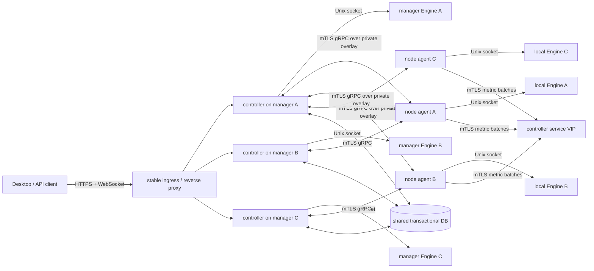
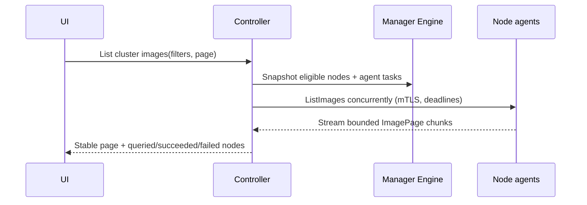

# Cluster communication in Kontainer v2

Status: proposed architecture and parity specification  
Research date: 2026-08-19  
Scope: controller-to-node communication, discovery, membership, security, fan-out, streaming, scheduling ownership, failover, and deployment in a Docker Swarm. Public desktop/API contract details and Docker resource reconciliation are covered only where they affect this boundary.

## Executive decision

Kontainer v2 should keep a narrow, protobuf-defined gRPC API between Kontainer processes and implement it with Tonic over HTTP/2 and mandatory mutual TLS. It should not expose the Docker Engine API over the network and should not introduce NATS, gossip, or an independent consensus system for v1 parity.

Deploy two explicit workloads from one Rust codebase:

- **Controller**: a service constrained to Swarm manager nodes. It serves the public API, reads and mutates Swarm-scoped state through the manager's local Docker Unix socket, discovers node-agent tasks, performs bounded fan-out, and owns scheduled coordination.
- **Node agent**: a global service on every supported node, including managers. It owns node-local Docker and host operations and exposes only the internal mTLS gRPC surface on a dedicated overlay network.

Do not encode either workload as an entry in one map keyed only by Swarm node ID. A controller and a node agent legitimately coexist on the same manager. Identity must distinguish `cluster_id`, `node_id`, workload kind, task/instance ID, and process boot ID.

For functional v1 parity, one controller replica with SQLite is acceptable as an explicitly non-HA profile. For production v2, run a controller on each manager (or at least three spread replicas), put durable state in a shared transactional database, and use a database lease plus idempotent operation claims only for singleton scheduled work. Public requests do not need an application leader: any healthy controller can serve them, and any active Swarm manager can serve manager Engine APIs. Docker already uses Raft for authoritative Swarm state; Kontainer must not build a competing election for it. Docker recommends an odd manager count and documents that management stops without manager quorum even while existing tasks continue to run ([Docker Swarm administration](https://docs.docker.com/engine/swarm/admin_guide/), [how nodes work](https://docs.docker.com/engine/swarm/how-swarm-mode-works/nodes/)).

The manager API already covers services, tasks, nodes, secrets, configs, Swarm networks, and Swarm service/task logs. Followers are genuinely required only for node-local state or execution: host utilization, live local container stats, images, local volumes/networks, container inspection/log fallbacks, and exec. Docker documents service/task logs as a manager-only cluster command, subject to logging-driver support ([`docker service logs`](https://docs.docker.com/reference/cli/docker/service/logs/)); `docker exec` operates on a running container, while default local volumes and images belong to an individual Engine ([`docker container exec`](https://docs.docker.com/reference/cli/docker/container/exec/), [volumes](https://docs.docker.com/engine/storage/volumes/), [`docker image ls`](https://docs.docker.com/reference/cli/docker/image/ls/)).

The non-negotiable v2 properties are:

- no plaintext internal RPC and no long-lived cluster-wide bearer secret;
- cryptographic node/workload identity bound to authoritative Swarm membership;
- a domain API, never a raw Docker proxy;
- explicit capabilities and protocol compatibility;
- bounded concurrency, payloads, queues, stream lifetimes, and deadlines;
- retry only when semantics make it safe, with durable idempotency for mutations;
- partial fan-out results that name every target and every failure;
- reconstructable membership, graceful churn, and no stale-address fallback;
- observable RPCs, fan-outs, streams, certificate state, and scheduler leases;
- rolling compatibility across the current and previous minor protocol versions.

## What v1 actually does

The current path is:

```text
React -> Tauri invoke -> leader HTTP/WebSocket API
                              | local Docker Engine
                              +-> follower gRPC -> follower local Docker Engine
```

`AGENT_ROLE=leader|follower` controls public API and scheduled-route registration. All processes register the same `AgentService` when gRPC is enabled; followers also retain unauthenticated HTTP `/health` and `/ping`. The relevant implementation is in:

- `server/app/services/cluster/{swarm_discovery,dev_discovery,registry,grpc_pool}.go`
- `server/app/providers/cluster_service_provider.go`
- `server/app/grpc/interceptors/secret_auth.go`
- `server/app/grpc/controllers/*.go`
- `server/proto/agent/agent.proto`
- `server/app/actions/{metrics,images}/*.go`
- `server/app/services/websocket/{exec_handler,exec_session}.go`
- `server/app/console/kernel.go`
- `docs/deployment.md`

### Discovery and registry

Every ten seconds in production, the leader asks its local manager Engine for desired-running tasks belonging to `CLUSTER_FOLLOWER_SERVICE`, lists all Swarm nodes for hostnames, selects the first address from the first network attachment on each running task, appends `GRPC_PORT`, and calls the custom `Health` RPC with a three-second timeout. Development instead pings a static comma-separated address list every five seconds.

Successful responses replace all follower entries in an in-memory `map[nodeID]*AgentInfo`; a manager query failure clears every follower immediately. The map keeps only node ID, hostname, address, string role/status, and a formatted `lastSeen`. There is no task ID, connection generation, certificate identity, capability record, protocol version, readiness reason, grace state, or persistent membership.

The documented production topology starts a single leader constrained to managers and a global follower service. Because a global service also runs on the leader's manager node, discovery receives a follower with the same node ID as the leader. `UpdateFollowers` preserves the old leader entry and then overwrites that map key with the follower. This is not a theoretical edge case; it follows directly from `docs/deployment.md` and the registry implementation.

### Transport and authentication

`GrpcPool` lazily creates one Go gRPC `ClientConn` per task address, caches it indefinitely, and injects `x-kontainer-secret` into unary and streaming metadata. Connections use `insecure.NewCredentials()`. The global unary server interceptor performs a constant-time comparison with one shared `CLUSTER_SECRET`; the exec handler must repeat the check manually because the framework wiring has no stream interceptor. Removed task addresses are not evicted unless a later health ping to that exact address fails, and `CloseAll` has no caller.

The proto has one unversioned `agent` package and one broad service:

```text
Health, Info, Metrics, ListImages, RemoveImage, PruneImages,
Exec(stream ExecMessage) returns (stream ExecMessage)
```

There is no capability handshake, standard gRPC health service, structured error detail, operation identity, idempotency key, request/audit context, message-size policy, or compatibility policy.

### Metrics and image fan-out

The leader's schedule runs discovery every ten seconds, metrics collection every minute, and pruning every five minutes. Metrics first collect local host/container data, then visit followers sequentially with a five-second per-follower deadline and insert each snapshot into SQLite. The configured `METRICS_INTERVAL` is not used by the schedule. `METRICS_RETENTION` is registered as `metrics.retention`, but the provider reads `metrics.retention_hours`, so the configured value is also ignored and its documented units disagree.

Image inventory likewise lists locally, then calls each registry entry sequentially. A local failure aborts the request; a follower failure is logged and silently omitted. Cluster-wide prune runs serially, silently omits follower failures, has no confirmation snapshot or idempotency record, and returns only aggregate totals. Remove routes to the leader when node ID is absent. None of these fan-outs has its own global budget, concurrency limit, completeness envelope, or stable result order.

### Exec routing

The public leader accepts a full JWT in a WebSocket query parameter and accepts a user-supplied `nodeID`. An absent node ID means “run on the leader.” A remote session is proxied WebSocket <-> bidirectional gRPC <-> Docker hijacked I/O. V1 does cancel the gRPC context and tries to unblock both relay goroutines when either direction ends, which is useful behavior to retain.

Several correctness and security gaps remain:

- It does not resolve the container from a fresh task record or prove that the selected node owns it.
- The follower trusts any caller holding the cluster secret to exec any container ID it can name.
- The remote controller sends `user`, but the follower ignores it.
- EOF is reported as exit code zero without inspecting the Docker exec result; local exec sends no reliable exit status.
- The proto enum makes `INIT` value zero, so an omitted/default type is accepted as initialization.
- Container ID is overloaded into a generic `bytes data` field; errors may expose raw daemon text.
- There are no frame, byte-rate, idle-time, session-count, or total-duration limits.
- An interactive stream is neither retryable nor resumable, but this is not stated in the contract.
- Query-string JWTs can leak through access logs, diagnostics, and copied URLs.

### V1 risk register

| Severity | Current weakness | Consequence | V2 treatment |
|---|---|---|---|
| Critical | gRPC is plaintext while a reusable cluster secret is sent on every call. The documented overlay is not encrypted. | Passive capture gives cluster-wide Docker-adjacent authority; active peers are not authenticated. | Mandatory mTLS, per-workload identities, no runtime shared bearer secret. |
| Critical | Every agent has a read/write Docker socket. | Agent compromise is effectively host-root control; Docker warns that daemon client keys or socket access can issue arbitrary daemon instructions and grant root access ([protect the Docker daemon socket](https://docs.docker.com/engine/security/protect-access/)). | Narrow RPC allowlist, no raw proxy, hardened container, smallest possible socket-owning process. Treat agent compromise as node compromise. |
| High | One static leader, in-memory registry, local SQLite, no election or shared state. | Restart causes blind discovery; host loss loses service; scheduled work has no safe takeover. | Multiple manager controllers plus shared DB and fenced/idempotent schedule ownership. |
| High | A single bearer secret authenticates neither node nor workload, and returned node IDs are trusted. | Any holder can spoof a node, overwrite registry identity, call destructive methods, or exec. | Certificate URI identity, task-IP/node membership binding, method authorization. |
| High | Global follower on the leader node collides in `map[nodeID]`. | Leader identity is overwritten; routing and inventory become ambiguous. | Separate controller and node-agent kinds; key by cluster/node/kind/instance/generation. |
| High | Destructive fan-out hides partial failure and has no deduplication. | A timeout/retry can repeat prune after some nodes succeeded; UI reports misleading totals. | Per-node result envelope, operation ledger, durable agent-side dedup journal. |
| High | Most unary calls have no explicit deadline; discovery and collection are serial. | One slow node makes latency and schedule duration grow linearly; calls may wait indefinitely because gRPC has no default deadline ([gRPC deadlines](https://grpc.io/docs/guides/deadlines/)). | Per-method and overall deadlines, bounded concurrent fan-out, cancellation propagation. |
| High | Exec target and end-user authorization are not bound to the stream. | Wrong-node execution, confused-deputy access, weak auditability. | Fresh task resolution and a short-lived, target-bound exec grant plus mTLS peer authorization. |
| Medium | Discovery takes the first arbitrary task network address and replaces the whole registry on every pass. | It can dial an unreachable/wrong network, flap on transient manager errors, or route to a stale/reused IP. | Select the configured network ID, generation-aware reconciliation, suspect grace, endpoint validation. |
| Medium | Address-keyed connections outlive membership and there is no drain lifecycle. | Stale sockets and long-running streams survive task replacement or removal. | Instance-keyed channel state machine, membership-driven drain and maximum stream lifetime. |
| Medium | Health says `ok` without checking Docker, Swarm role, disk, or capabilities. | Liveness is mistaken for readiness and requests route to incapable agents. | Standard liveness plus explicit readiness/capability detail. |
| Medium | Metrics/images are unbounded unary snapshots with no compression or paging. | Large clusters can exceed message/memory limits and create collection spikes. | Chunked streams/batches, explicit limits, conditional compression and backpressure. |
| Medium | Errors collapse to `Internal` and sometimes include daemon strings. | Callers cannot distinguish retryable failures and sensitive detail can escape. | Stable gRPC codes plus redacted typed details. |
| Medium | No protocol version or compatibility tests. | Rolling updates can fail unpredictably. | Versioned package, add-only evolution, N/N-1 matrix and breaking-change CI. |

There are currently no focused tests for discovery, the connection pool, the secret interceptor, multi-node image actions, gRPC exec, or membership churn. The v2 acceptance suite must cover those seams before replacing v1.

## Authority: manager API versus node agent

Swarm managers maintain cluster state, schedule services, and serve the Swarm HTTP API; workers execute containers and do not serve those Swarm endpoints ([Docker node model](https://docs.docker.com/engine/swarm/how-swarm-mode-works/nodes/)). The correct routing boundary is therefore resource ownership, not a blanket “all multi-node work goes through followers.”

| Operation/data | Authority and v2 route | Node agent needed? |
|---|---|---|
| Services, desired task records, nodes, stacks, secrets, configs | Controller's local manager Engine | No |
| Swarm overlay networks and cluster volumes | Controller's local manager Engine | No, except an optional local observation |
| Service/task logs | Controller's manager Engine; surface driver limitations | No for Swarm logs |
| Swarm events | Each controller's local manager Engine; resync after reconnect | No. Swarm-scoped events are visible on managers ([Docker events](https://docs.docker.com/reference/cli/docker/system/events/)). |
| Static node capacity/Engine version | Manager node records plus agent capability detail | Only for richer local facts |
| Host CPU/memory/disk utilization | Node agent, sampled in the correct host namespaces | Yes |
| Live container CPU/memory/network/block I/O | Node agent connected to that container's Engine | Yes |
| Images and image prune/remove/pull | Named node agent; preserve node provenance | Yes |
| Exec | Resolve task on manager, execute through its named node agent | Yes |
| Standalone/local container logs and inspect | Named node agent | Yes |
| Local volumes, bridge/host networks, plugins | Named node agent | Yes |

If Kontainer dropped images, live metrics, exec, and other node-local features, it could drop followers entirely. Given the current product, a global node agent is justified. It should not participate in Swarm desired-state CRUD just because it has a socket.

## Transport and coordination alternatives

| Option | Decision | Why |
|---|---|---|
| **gRPC/HTTP/2 with Tonic + Rustls** | **Accepted** | Preserves the useful v1 protobuf boundary and bidirectional exec stream, adds generated Rust types, deadlines, status, metadata, standard health, compression and transport flow control. Tonic is a Rust gRPC/HTTP/2 stack built on Hyper/Tower with Rustls support ([Tonic project](https://github.com/hyperium/tonic), [Tonic transport](https://docs.rs/tonic/latest/tonic/transport/)). |
| **Raw HTTPS/HTTP/2 or WebSocket between agents** | **Rejected internally; retained at the public edge** | It can work, but Kontainer would rebuild schema compatibility, streaming frames, status mapping, deadlines, and generated clients. JSON is useful for desktop-facing APIs, not for high-volume internal fan-out. |
| **QUIC/Quinn or HTTP/3** | **Deferred behind benchmarks** | QUIC provides TLS 1.3, path migration, and avoids head-of-line blocking between streams ([RFC 9000](https://www.rfc-editor.org/rfc/rfc9000.html)); Quinn is mature enough to prototype ([Quinn](https://github.com/quinn-rs/quinn)). The current traffic is within a stable Swarm overlay, not a lossy mobile WAN. QUIC adds UDP firewall/MTU/observability work and no ready replacement for the gRPC service ecosystem. Revisit only if packet-loss tests show HTTP/2 stream coupling is material. Never enable 0-RTT for mutations or exec because replay semantics are weaker. |
| **Core NATS request/reply** | **Rejected for parity** | It adds a broker cluster, another identity/authorization plane, subject governance, and request correlation without removing the need for domain auth or idempotency. Core NATS is at-most-once and does not retain messages for offline subscribers ([Core NATS](https://docs.nats.io/learn/core-nats/)). |
| **NATS JetStream** | **Deferred for large asynchronous telemetry/event workloads** | JetStream adds persistence, acknowledgements, redelivery, and at-least-once delivery ([JetStream](https://docs.nats.io/concepts/jetstream)). That can be valuable for multi-site or very large telemetry deployments, but it is disproportionate for v1 RPC parity and creates duplicate durable state beside Kontainer's database. |
| **Gossip membership** | **Rejected** | Swarm managers already provide authoritative node and service-task membership. Gossip is eventually consistent, does not elect the Swarm leader, and would introduce a second identity/address truth that can disagree during partitions. |
| **Controller directly uses its local manager Docker API** | **Accepted for Swarm-scoped operations** | It is the shortest and authoritative path, and any active manager serves the Swarm API. Keep the client behind Kontainer domain actions. |
| **Controller connects to every remote Docker daemon** | **Rejected** | It requires exposing root-equivalent daemon access on the network and still needs per-node routing, TLS, authorization and version handling. The Docker docs explicitly warn that daemon credentials grant root-level authority ([daemon socket protection](https://docs.docker.com/engine/security/protect-access/)). |
| **Controller tunnels raw Docker API through followers** | **Rejected** | It violates the existing architectural rule that the agent is not a socket proxy and turns every daemon endpoint into the public attack surface. Expose only stable, validated Kontainer operations. |

gRPC itself preserves order within each RPC and gives independent read/write sides for bidirectional streams ([gRPC core concepts](https://grpc.io/docs/what-is-grpc/core-concepts/)). HTTP/2 transport flow control prevents an unchecked sender from overrunning a receiver, but application queues and Docker reads still need explicit bounds ([gRPC flow control](https://grpc.io/docs/guides/flow-control/)). Those properties fit inventory, telemetry, and terminal I/O without pretending to provide exactly-once execution.

## Proposed deployment topology



### Workload layout

`kontainer-controller` should run on manager nodes with one task per manager for the HA profile. A replicated service with `max_replicas_per_node=1` is also viable, but global-plus-manager-constraint naturally follows manager membership. Each replica is independently ready only when its database and local manager Engine are ready. The public load balancer removes unready replicas. Long-running WebSocket/log/exec sessions remain pinned to the accepting controller for their lifetime; controller loss ends the session cleanly rather than attempting unsafe transparent migration.

`kontainer-node-agent` should be a global service on all nodes. Manager nodes deliberately run both workloads. The controller never pretends to be the local node-agent entry, and node-local calls on a manager still go to its node agent. This removes v1's special `leaderNodeID` fallback and keeps one routing rule for every node.

The private control network should be a dedicated, non-attachable overlay shared only by these two services. Do not publish the node-agent gRPC port through the routing mesh. Controllers dial the exact task address on this network, never the service VIP, because a node-specific call must not be load-balanced to another node. Configure the controller's internal endpoint as DNSRR so enrollment/telemetry clients also reach a controller task directly rather than traversing an address-hiding VIP; public ingress is separate. Docker supports direct task discovery through `tasks.<service>` and both VIP and DNSRR service-discovery modes ([Swarm networking](https://docs.docker.com/engine/swarm/networking/)); Kontainer still uses manager task records so it can bind an address to a node and task generation.

Use mTLS even when the overlay has `--opt encrypted`. Docker encrypts Swarm management traffic, but application data on overlay networks is not encrypted by default; encrypted overlays use IPsec and have a documented performance cost ([Swarm networking](https://docs.docker.com/engine/swarm/networking/), [overlay driver](https://docs.docker.com/engine/network/drivers/overlay/)). Overlay encryption is defense in depth and a deployment choice; mTLS is the application security boundary.

### Runtime hardening

Both workloads are highly privileged because they can drive Docker. A read-only bind flag on `/var/run/docker.sock` does not make Docker API calls read-only. The production service definitions should:

- run a minimal, pinned image as a non-root UID when socket group ownership permits;
- drop Linux capabilities, set `no-new-privileges`, use a read-only root filesystem, and allocate explicit writable paths;
- avoid host PID/network namespaces and privileged mode;
- mount `/host/proc` or host filesystem data only when the corresponding metric is enabled and only read-only;
- keep the public port off the node-agent service and the internal gRPC port off public ingress;
- store agent private keys and the local dedup journal in a permission-restricted per-node volume;
- define CPU/memory/PID limits and graceful shutdown periods long enough to drain RPCs;
- sign images, pin production image digests, emit an SBOM, and scan the Rust/container dependency chain;
- never log Docker authorization headers, registry credentials, certificate keys, exec I/O, environment values, secret/config data, or full query strings.

The controller's socket still has host-root consequence. Splitting it from the node agent reduces exposed methods and lets the public process be reviewed separately, but it is not a sandbox against a controller remote-code-execution bug. A future local privileged helper could reduce the HTTP process's socket access, but that is defense in depth, not a reason to create a network Docker proxy.

## Controller leadership, manager failover, and schedules

There are three different concepts that v2 must not conflate:

1. **Swarm Raft leader**: selected by Docker managers. Kontainer does not elect or address it directly. A controller calls its local active manager Engine, which participates in Docker's consensus.
2. **Public/API controller**: every ready controller can serve reads and user mutations. The load balancer performs discovery; clients never store a controller task IP.
3. **Scheduled-work owner**: at most one controller should enqueue a given scheduled occurrence. This is a short database lease, not cluster membership and not a second consensus system.

### Controller state machine

```text
STARTING
  -> STANDBY       DB reachable, local manager ready, public API ready
  -> ACTIVE        schedule lease acquired; may claim new scheduled occurrences
  -> DRAINING      SIGTERM, manager demotion, or lease renewal at risk
  -> STOPPED

STANDBY <-> ACTIVE
ACTIVE  -> STANDBY immediately on failed renewal or lost manager readiness
ANY     -> NOT_READY when DB or local manager is unavailable
```

Use one lease row such as `{name, holder_instance_id, term, expires_at}` and database server time. Acquisition/renewal must be one conditional transaction; every takeover increments the monotonic term. Renew at roughly one third of the lease duration with jitter. A controller that cannot renew stops claiming work immediately and cancels cancellable schedule contexts.

A lease alone cannot fence an already issued Docker request. Scheduled mutations therefore also require a durable operation claim with a unique natural key such as `(schedule_id, planned_at, target_id)`, request hash, lease term, status, attempt, and result. Before reissuing an uncertain operation, inspect current Docker state. Convergent “set desired value” operations may continue; edge-triggered operations such as `ForceUpdate++` or prune must return an uncertain/needs-review state unless the agent/controller dedup record proves the prior result.

Discovery, health probing, Engine event watchers, certificate refresh, and local cache maintenance are per-controller activities and do not need the singleton lease. Metrics ingestion is sharded naturally by whichever controller accepts the agent stream and deduplicated in shared storage.

### Failure behavior

- **One controller dies:** public traffic moves to another ready controller. Unary callers may retry only according to method policy. Active logs/exec end and the UI offers reconnect; exec is never replayed.
- **A manager is demoted or its Engine fails:** its controller becomes unready and releases/stops renewing schedule ownership. Swarm removes a manager-constrained task after demotion. Other manager controllers continue.
- **Manager quorum is lost:** reads that the local Engine can still answer may be marked stale; Swarm mutations return `FAILED_PRECONDITION`/`UNAVAILABLE` with `quorum_unavailable`. Do not redirect writes to workers. Existing workloads may continue even though management cannot ([Docker Swarm administration](https://docs.docker.com/engine/swarm/admin_guide/)).
- **Database is lost:** public writes, auth/session changes, idempotency claims, and scheduled work fail closed. Cached resource reads may be allowed with an explicit stale marker. Agents buffer a bounded amount of telemetry.
- **The singleton compatibility controller dies:** Swarm reschedules it on a manager, but local SQLite or a local volume does not follow it. This is why that profile is not production HA.

## Discovery, identity, enrollment, and membership

### Authoritative discovery

Each controller maintains an ephemeral routing registry rebuilt from its local manager Engine:

1. List tasks for the configured node-agent **service ID**, desired state `running`; do not trust a mutable name alone.
2. Keep only tasks whose actual state is running and whose service labels identify the expected Kontainer cluster and workload kind.
3. Select the address belonging to the configured control-network **ID**. Never take the first network attachment.
4. Validate that the IP belongs to that network's configured subnet and construct a non-user-controlled endpoint.
5. Connect with mTLS and call standard health plus `AgentInfo.Describe` concurrently under a bounded semaphore.
6. Require certificate `cluster_id` and `node_id`, response node ID, and manager `Task.NodeID` to agree.
7. Resolve rolling-update duplicates by service generation/task creation time and readiness; mark the older endpoint draining before removal.
8. Reconcile removals and changed addresses into the channel manager. Never retain a missing endpoint as a routable fallback.

Subscribe to manager Engine service/task/node events for prompt invalidation, but perform a full reconciliation at startup, after every event-stream reconnect, and periodically with jitter. Docker says Swarm-scoped events are visible on managers, but events are not a durable state store ([Docker events](https://docs.docker.com/reference/cli/docker/system/events/)). A thirty-second full pass and event-driven invalidation are reasonable starting values; benchmark before fixing them as an SLO.

DNS `tasks.<node-agent-service>` is a bootstrap/debug fallback, not the authoritative registry. It returns task addresses but not the trusted node/task mapping and may include both generations during rollout.

### Identity model

Use a private PKI trust domain and URI SANs. An illustrative identity is:

```text
spiffe://kontainer.internal/swarm/<cluster-id>/node/<node-id>/agent
spiffe://kontainer.internal/swarm/<cluster-id>/controller/<controller-instance-id>
```

The names are SPIFFE-shaped so policy is unambiguous, but v2 need not require SPIRE. The authenticated identity comes only from the verified peer certificate. Hostname, Engine role, task ID, advertised address, version, and capabilities are observations and may change; they are not authorization identities.

Do not mount or reuse Docker's Swarm node private key. Docker's own PKI gives each node a cryptographic node ID, uses mTLS internally, and rotates node certificates by default every three months ([Docker Swarm PKI](https://docs.docker.com/engine/swarm/how-swarm-mode-works/pki/)). That makes the node ID an excellent binding target, but Docker does not expose its node certificate as a supported application credential. Reusing the private key would couple Kontainer to daemon internals and expand the blast radius of a Swarm control-plane key.

### Bootstrap enrollment

The baseline issuer is a pluggable Kontainer CA: keep the root offline, keep a short-lived online intermediate available only to the enrollment component, and distribute only the trust bundle to workloads. An external `step-ca` or SPIFFE/SPIRE issuer should be supported by the same interface. SPIFFE's Workload API streams rotated X.509 identities and trust bundles and is the higher-assurance choice for operators that already run SPIRE ([SPIFFE Workload API](https://spiffe.io/docs/latest/spiffe-specs/spiffe_workload_api/), [working with SVIDs](https://spiffe.io/docs/latest/deploying/svids/)). gRPC supports TLS encryption/server authentication and client certificates for mutual authentication ([gRPC authentication](https://grpc.io/docs/guides/auth/)).

Serve initial enrollment on a separate, private, server-authenticated TLS listener/service that exposes only `Enroll`, with strict rate/body limits. Serve `Renew` on the ordinary controller listener where a valid client certificate is mandatory. Normal node-agent RPC listeners always require a client certificate. Disable the bootstrap listener when no enrollment window/token is active.

For the built-in bootstrap flow:

1. The agent generates its private key locally and sends a CSR, boot nonce, claimed node ID, task ID, cluster ID, and protocol range over server-authenticated TLS.
2. It presents a short-lived enrollment token. This token is for certificate issuance only and is never accepted by normal RPCs.
3. The agent connects to a direct controller task through the DNSRR internal endpoint. The controller maps the connection's preserved source address to a currently running node-agent task on the control network, then requires the task ID and `Task.NodeID` to match the CSR claims. The deployment acceptance test must prove source preservation. If the platform/proxy hides it, this bootstrap profile is not sufficiently binding and must use a per-node ticket or external attestation instead.
4. The issuer consumes the nonce/token and issues a certificate containing only the verified cluster/node/workload URI and appropriate client/server EKUs.
5. The agent stores key/cert atomically with restrictive permissions, reconnects with mTLS, and deletes its token material when the deployment mechanism permits.

The initial token should be delivered as a Docker secret, never a service environment variable. A single reusable bootstrap secret is still weaker than per-node one-time tickets; source-task binding and short validity limit its value but do not make it hardware attestation. Dynamic node addition, per-node token delivery, and SPIRE/TPM attestation are an explicit open decision below.

### Certificate lifecycle

- Leaf lifetime: start at 24 hours; renew after about two thirds with randomized jitter. Short-lived certificates reduce the need for perfect revocation and force regular key/cert health. Smallstep documents the same short-lived/automatic-renewal pattern ([certificate renewal](https://smallstep.com/docs/step-ca/renewal/)).
- Renewal: authenticate with the still-valid mTLS identity, prove possession of the new CSR key, and re-check current Swarm task/node membership. Do not renew an expired or removed identity automatically.
- Revocation: removal from authoritative membership denies new calls immediately through a short-TTL authorization cache. Support certificate serial denylisting/CRLs for compromise response; Rustls can enforce client CRLs through `WebPkiClientVerifier` ([Rustls client verifier](https://docs.rs/rustls/latest/rustls/server/struct.WebPkiClientVerifier.html)).
- Root/intermediate rotation: publish old+new trust bundles, issue new leaves, verify fleet convergence, then remove old trust. Never replace roots in one step.
- TLS profile: require TLS 1.3 with ALPN `h2`, trusted-root and name verification, client certificates on normal RPC, and no insecure verifier/test CA in production. Include a stable DNS SAN derived from the verified node ID so controllers can set the expected server name while dialing an ephemeral task IP; additionally enforce the workload URI SAN in authorization.
- Hot reload: Tonic's convenient TLS builders accept server identity and a client CA ([`ServerTlsConfig`](https://docs.rs/tonic/latest/tonic/transport/server/struct.ServerTlsConfig.html)), but file replacement alone does not prove new handshakes use new material. Use a tested dynamic Rustls acceptor/resolver or gracefully rebuild listeners/channels. Rustls exposes `ResolvesServerCert` and `ResolvesClientCert` for selecting current certified keys ([server resolver](https://docs.rs/rustls/latest/rustls/server/trait.ResolvesServerCert.html), [client resolver](https://docs.rs/rustls/latest/rustls/client/trait.ResolvesClientCert.html)).
- Existing streams: cap their lifetime to the lesser of configured maximum and remaining certificate lifetime, re-check membership periodically, and drain before the identity expires. A TLS handshake does not retroactively revoke a live HTTP/2 connection.

### Membership state machine

```text
DISCOVERED -> ENROLLING -> PROBING -> READY -> DRAINING -> REMOVED
                              |         |
                              v         v
                           DEGRADED -> SUSPECT
                              ^         |
                              +---------+

Any identity/task mismatch -> QUARANTINED
Missing authoritative task -> DRAINING immediately, then REMOVED
Transient probe failure -> SUSPECT, not immediate deletion
```

`READY` means process, Docker adapter, identity, protocol, and required capability checks passed. `DEGRADED` identifies an explicit unavailable capability. `SUSPECT` is usable only for non-sensitive cached display; new mutations and exec fail closed. Suggested initial thresholds are two failed probes to become suspect and one successful authenticated probe plus authoritative membership to recover. Do not wait for a long grace period when the manager says the task or node was removed.

Store at least:

```text
AgentEndpoint {
  cluster_id, node_id, workload_kind, service_id, task_id,
  endpoint_generation, address, certificate_serial,
  agent_version, protocol_min, protocol_max, negotiated_protocol,
  engine_api_version, os, arch, capabilities[], readiness_reasons[],
  process_boot_id, observed_at, last_success_at, state
}
```

The registry is a routing cache, not the source of Swarm truth. It may be independently rebuilt by every controller and need not be replicated through gossip.

## Authentication and authorization

mTLS answers “which Kontainer workload is this?” It does not answer “may the logged-in user exec into this container?” Enforce both layers:

- TLS verifies the trust domain, cluster ID, workload kind, node ID and EKUs. Do not authorize on certificate CN or a claimed protobuf field.
- A Tower middleware layer extracts the verified peer identity, sets a typed request extension, applies global size/concurrency/rate limits, and creates trace/audit context. Tonic interceptors are suitable for metadata checks but Tonic recommends Tower for more powerful middleware ([Tonic interceptor API](https://docs.rs/tonic/latest/tonic/service/trait.Interceptor.html)).
- Each RPC has a policy: allowed caller workload kinds, required node capability, target node equality, input constraints, and whether end-user delegation is required.
- The controller forwards a short-lived signed `DelegationGrant` for high-risk operations. It contains `issuer_controller_id`, `principal_id`, permission, cluster/node/resource IDs, request ID, issued/expiry time, nonce, and request hash. The node agent verifies signature, target, expiry, nonce, and its own membership. It never trusts roles supplied as plain metadata.
- Delegation uses a controller-specific, issuer-certified signing key distinct from its TLS private key. Grants carry a key ID; the authenticated mTLS controller identity must match the grant issuer. Agents keep a short-overlap public-key bundle for rotation and a bounded replay cache for grant nonces.
- `Exec`, image deletion/prune, and future host-affecting mutations require grants. Read-only health and inventory require authenticated controller identity but may not require an end-user grant.
- Audit records include principal, controller and agent identities, target, policy decision, request/operation ID, outcome, byte counts and duration. They exclude terminal/log payloads and secret values.

The controller certificate is powerful, so split issuance policy between controller and node-agent identities and keep the online signing intermediate out of agents. Rate-limit authentication failures before expensive application work, but do not expose whether a particular node/resource exists to an unauthenticated peer.

## Protocol and service boundaries

Use a versioned protobuf namespace such as `kontainer.agent.v2`; do not put `v2` only in a build string. Split services by policy, resource limits, and traffic class rather than retaining one broad `AgentService`.

```proto
package kontainer.agent.v2;

// Standard grpc.health.v1.Health is registered separately.
service AgentInfo {
  rpc Describe(DescribeRequest) returns (AgentDescription);
}

service NodeMetrics {
  // Pull path required for v1 parity and diagnostics.
  rpc CollectSnapshot(CollectSnapshotRequest) returns (MetricBatch);
}

service ImageInventory {
  rpc ListImages(ListImagesRequest) returns (stream ImagePage);
}

service NodeMaintenance {
  rpc RemoveImage(RemoveImageRequest) returns (RemoveImageResponse);
  rpc PruneImages(PruneImagesRequest) returns (OperationResult);
}

service ContainerExec {
  rpc Exec(stream ExecClientFrame) returns (stream ExecServerFrame);
}

// Served by controllers; agents are clients. This is a v2 production path,
// not required to reproduce v1's pull collector.
service TelemetryIngest {
  rpc Export(stream MetricBatch) returns (stream TelemetryAck);
}
```

The separate `kontainer.enrollment.v2` package defines `BootstrapEnrollment.Enroll` on the restricted server-authenticated bootstrap listener and `CertificateRenewal.Renew` on the controller mTLS listener. Neither service is registered on the ordinary node-agent server.

The sketch groups the boundary for readability. In source, `TelemetryIngest` belongs to `kontainer.controller.v2`, the two certificate services belong to `kontainer.enrollment.v2`, and the node-served services remain in `kontainer.agent.v2`.

Add node-local volume/network/container services only when their product contracts are implemented. Do not add a generic `DockerRequest`, arbitrary URI/path, raw JSON spec, arbitrary command runner, or socket tunnel. Swarm resource methods do not belong in this internal node-agent protocol while controllers run on manager nodes and can call the local manager socket.

### Common messages

The exact field numbers need review before code generation, but the semantic envelope should include:

```proto
message RequestMeta {
  string request_id = 1;
  string operation_id = 2;
  string idempotency_key = 3;
  DelegationGrant delegation = 4;
}

message AgentDescription {
  WorkloadIdentity identity = 1;
  ProtocolRange protocol = 2;
  BuildInfo build = 3;
  EngineInfo engine = 4;
  repeated Capability capabilities = 5;
  repeated ReadinessReason readiness = 6;
  google.protobuf.Timestamp observed_at = 7;
}

message ProtocolRange {
  uint32 min_major = 1;
  uint32 min_minor = 2;
  uint32 max_major = 3;
  uint32 max_minor = 4;
}

message NodeResult {
  string node_id = 1;
  Outcome outcome = 2;
  google.rpc.Status error = 3;
  bool retried = 4;
  google.protobuf.Timestamp observed_at = 5;
}
```

Use `oneof` for exec frames, not a type enum plus unrelated optional fields. Every enum reserves zero for `*_UNSPECIFIED` so an omitted value is invalid.

```proto
message ExecClientFrame {
  oneof frame {
    ExecOpen open = 1;
    bytes stdin = 2;
    TerminalResize resize = 3;
    ExecSignal signal = 4;
    ExecClose close = 5;
  }
}

message ExecServerFrame {
  oneof frame {
    ExecStarted started = 1;
    bytes stdout = 2;
    bytes stderr = 3; // omitted/merged when tty=true
    ExecExit exit = 4;
    StreamWarning warning = 5;
  }
}
```

`ExecOpen` carries task ID, container ID, expected node ID, TTY, argv from an allowlisted shell policy, user, dimensions, delegation grant, and request ID. `ExecStarted` returns an opaque session ID and effective options. `ExecExit` carries the actual Engine-inspected code and optional signal/reason. Protocol errors are gRPC status, not an in-band generic error frame; terminal lifecycle events remain in-band.

### Compatibility and rolling upgrades

Protobuf additions are usually wire-safe, but field-number reuse and incompatible type changes are not; deleted field numbers and names must be reserved ([Proto 3 evolution](https://protobuf.dev/programming-guides/proto3/), [protobuf best practices](https://protobuf.dev/best-practices/dos-donts/)). Apply these rules:

- The controller supports its own minor and the previous minor within protocol major 2. Agents advertise an explicit min/max range and granular capabilities.
- Major mismatch fails `FAILED_PRECONDITION` with supported ranges. Minor negotiation chooses the highest intersection; absence of a capability is authoritative even if a version would normally imply it.
- Add fields and RPCs; never change the meaning/type of an existing field or enum number. Reserve removals. Treat unknown enum values as unknown, not fatal.
- Run `buf lint` and `buf breaking` against the last released schema in CI; generate a descriptor set and record its digest in build info.
- Test controller N with agents N and N-1, then controller N+1 with agent N before rollout approval.
- Roll agents first when a controller can tolerate both; roll controllers first when introducing a purely optional RPC. Capability gates keep new UI/actions disabled until all required targets support them.
- A rolling duplicate on one node is one node with two endpoint generations, not two nodes. Route new unary work to the new ready generation and drain streams on the old one.

### Status and error details

Map stable domain failures to gRPC codes and attach typed, redacted details such as `google.rpc.ErrorInfo`, `RetryInfo`, `ResourceInfo`, and a Kontainer `OperationFailure`. Examples:

| Condition | Code | Retry rule |
|---|---|---|
| malformed ID/filter/frame | `INVALID_ARGUMENT` | Never |
| absent/invalid peer identity | `UNAUTHENTICATED` | Re-enroll/repair identity |
| peer or delegated principal lacks permission | `PERMISSION_DENIED` | Never without policy change |
| task replaced, container stopped, capability absent, quorum lost | `FAILED_PRECONDITION` | Re-resolve state; do not blind retry |
| resource absent | `NOT_FOUND` | Only convergent delete with `ignore_missing` |
| expected version changed | `ABORTED` | Re-read and deliberately reapply |
| idempotency key reused with another hash | `ALREADY_EXISTS` | Never |
| message/rate/concurrency limit | `RESOURCE_EXHAUSTED` | Back off per `RetryInfo` |
| agent/Engine temporarily unreachable | `UNAVAILABLE` | Safe/idempotent methods only |
| budget exhausted | `DEADLINE_EXCEEDED` | Result may be uncertain for mutations |
| caller cancelled | `CANCELLED` | Never assume the operation rolled back |
| unexpected defect | `INTERNAL` | Alert; no daemon details to caller |

gRPC explicitly allows client and server to disagree about whether an operation completed around cancellation/deadline boundaries; changes are not rolled back by cancellation ([gRPC lifecycle](https://grpc.io/docs/what-is-grpc/core-concepts/)). Mutation APIs must therefore return/retain operation identity and support inspection after an uncertain transport result.

## Tonic connection management

Maintain a channel state object keyed by `(cluster_id, node_id, task_id, endpoint_generation, traffic_class)`, not raw address. The endpoint generation changes when address, certificate identity, or task changes.

### Channel policy

- Reuse one Tonic `Channel` for ordinary unary/inventory RPCs per ready endpoint. Tonic channels multiplex HTTP/2 and are intentionally cheap to clone because they use a buffered background service ([Tonic `Channel`](https://docs.rs/tonic/latest/tonic/transport/struct.Channel.html)).
- Use a second channel for long-lived exec/log streams when benchmarks show unary queueing behind concurrent-stream limits. gRPC recommends channel reuse, but also notes that long-lived streams can consume a connection's concurrent-stream capacity and may warrant separate channels ([gRPC performance guidance](https://grpc.io/docs/guides/performance/)). Do not create a connection per request.
- Configure connect/TLS-handshake timeouts, TCP keepalive, HTTP/2 keepalive, per-request concurrency, rate limits, adaptive flow-control windows only after measurement, and explicit maximum encode/decode sizes. Tonic's `Endpoint` exposes these controls; its `timeout` alone does not transmit `grpc-timeout`, so set each `Request` timeout as well ([Tonic `Endpoint`](https://docs.rs/tonic/latest/tonic/transport/struct.Endpoint.html)).
- Suggested starting values: 2 s connect and TLS handshake; 60 s HTTP/2 keepalive interval with a 10 s acknowledgement timeout; keepalive while idle only for stream-class channels; 64 concurrent ordinary RPCs per agent; 8 concurrent expensive Docker RPCs; 4 concurrent execs per node and a configurable cluster/user quota. Avoid aggressive sub-minute keepalives because the gRPC guidance warns they can be treated as abusive; keepalive tests connection state, not service health ([gRPC keepalive](https://grpc.io/docs/guides/keepalive/)).
- Use the standard `grpc.health.v1.Health` service. Report liveness separately from `AgentInfo.Describe` readiness. Streaming `Watch` may reduce probe load where Tonic client behavior is verified; gRPC defines both `Check` and scalable `Watch` health modes ([gRPC health checking](https://grpc.io/docs/guides/health-checking/)).
- On endpoint removal, mark the channel draining, reject new calls, cancel unauthorized/high-risk streams, allow a short bounded grace for safe streams, then drop all channel handles. On address reuse, never attach the old identity state to the new socket.

### Deadlines, retry, and backoff

Every RPC receives the smaller of the public-request remaining budget and its method cap. Initial budgets to validate under load are:

| RPC/work | Per-node cap | Overall behavior |
|---|---:|---|
| TLS connect / health | 2 s / 1 s | Discovery fan-out capped at 32, full pass <= 10 s target |
| Describe/capabilities | 2 s | One retry only during discovery if connection changed |
| Metrics snapshot | 5 s | Partial sample; never delay the next interval |
| Image page/list | 10 s | Overall public request 15 s; return partial nodes |
| Remove image | 30 s | Idempotency required; inspect on uncertain result |
| Prune | Async operation, 5 min default cap | Never hold a public HTTP request for convergence |
| Exec open | 5 s | Session then uses idle/maximum lifetime, not a unary deadline |
| Telemetry export ack | 5 s | Reconnect/backoff; resend unacked sequence range |

Retry `UNAVAILABLE`, connection reset before response headers, and selected `RESOURCE_EXHAUSTED` only for read-only or idempotency-protected calls. Use capped exponential backoff with full jitter, for example 100 ms base, 1.6 multiplier, 10 s cap, and a cluster-wide retry budget. Do not retry `INVALID_ARGUMENT`, auth failures, capability failures, or interactive streams. Wait-for-ready can queue bounded background health/telemetry calls within a deadline, but user calls should usually fail fast; gRPC documents that wait-for-ready remains subject to the deadline ([wait-for-ready](https://grpc.io/docs/guides/wait-for-ready/)).

Automatic retry policy is not a substitute for application semantics. gRPC retry creates a new stream after a configured retryable status and backoff ([gRPC retry](https://grpc.io/docs/guides/retry/)); Kontainer still decides whether repeating the Docker action is safe.

### Circuit breaking and flow control

Track failures per endpoint and per capability. After a configurable consecutive-failure threshold, open a circuit for a jittered cool-down while health probes continue at low rate. A successful authenticated readiness check closes it. Do not let failure of expensive metrics collection disable a healthy exec capability; health dimensions must be separate.

Bound all producer/consumer queues. A stream write completing means gRPC accepted the message into its transport machinery, not that the peer application processed it ([gRPC flow control](https://grpc.io/docs/guides/flow-control/)). Telemetry acknowledgement therefore reports a durable sequence watermark. Exec has small bounded relay channels; a slow browser eventually backpressures Docker reads and the session is cancelled if the queue remains full. No `spawn`ed task may outlive its request/session cancellation token.

### Batching, paging, and compression

- Image inventory streams deterministic pages of at most 256 records and at most 1 MiB encoded, with a final page carrying count/digest/observation time. The controller may stop early when the public page is satisfied.
- Metric batches target 64–256 KiB or at most one second of samples, whichever comes first, and include agent boot ID plus monotonically increasing sequence range.
- Exec frames are capped at 32 KiB. Coalesce tiny writes for at most a few milliseconds only when measurement shows a win; terminal latency wins over packet efficiency.
- Accept and send gzip or Zstd only for inventory/telemetry payloads above a measured threshold. Tonic currently supports gzip, deflate, and Zstd feature-gated encodings plus explicit message-size limits ([Tonic compression](https://docs.rs/tonic/latest/tonic/codec/enum.CompressionEncoding.html)). Do not compress exec, credentials, small control messages, or already-compressed log chunks; gRPC permits per-message compression choices ([gRPC compression](https://grpc.io/docs/guides/compression/)).
- Apply decompressed-size, ratio, CPU-time and nesting/count limits so a small compressed request cannot allocate unbounded memory.

## Fan-out and fan-in semantics

Build one shared fan-out executor rather than open-coding loops in metrics and images.

```text
FanoutPlan {
  request_id,
  authoritative_target_snapshot[],
  max_concurrency,
  per_target_deadline,
  overall_deadline,
  retry_policy,
  completeness_policy
}

FanoutResult<T> {
  requested_nodes[], queried_nodes[], successful_nodes[], failed_nodes[],
  skipped_nodes[{node_id, reason}], results[{node_id, value}],
  snapshot_at, completed_at, complete, warnings[]
}
```

Take a stable target snapshot before launching calls. Execute with `FuturesUnordered`/`buffer_unordered` and a global semaphore, propagate cancellation, and collect all outcomes until the overall deadline. Sort the response by node ID or requested order. A node disappearing mid-call is `node_replaced`/`node_unreachable`, not an empty list. A newly appearing node is discovered for the next request rather than silently expanding the current mutation target.

Read fan-out returns useful partial data with `complete=false`; the HTTP layer may use a normal 200 response with an explicit completeness envelope if that is the established public contract. A multi-node mutation returns a durable operation with per-node terminal/uncertain states; it must never return only aggregate success counts.

## Workload-specific flows

### Image inventory and maintenance



Image IDs/tags remain node-qualified. Cluster deduplication may add a derived digest grouping, but must not erase placement. `RemoveImage` requires an explicit node; never default missing node identity to the controller host. `PruneImages` requires target node IDs, filters/preview or confirmation, idempotency key, principal grant, and an operation record. The node agent journals `(controller identity, idempotency key, request hash, result)` for a bounded retention window so reconnect does not repeat a completed destructive call.

The controller limits fan-out concurrency independently from per-agent Docker concurrency. For “all ready nodes,” the operation stores the exact initial target set; nodes added later are not silently pruned.

### Metrics

V1 parity may initially retain `CollectSnapshot`, but it must run in parallel, carry sample start/end times, and return per-node failures. Do not preserve the hard-coded one-minute schedule or the broken retention key.

The production v2 path is push-based:

1. Each agent samples host and local-container metrics on a jittered interval.
2. It assigns `(node_id, process_boot_id, sequence)` and appends to a bounded local ring buffer.
3. It maintains one mTLS `TelemetryIngest.Export` stream to the stable internal controller service, sends batches, and receives the highest durably committed sequence as `TelemetryAck`.
4. On disconnect it retries with backoff and resends only unacknowledged batches. The database unique key deduplicates them.
5. When the buffer reaches its byte/age limit, it drops oldest metrics, increments a dropped-sample counter, and reports the sequence gap. Metrics availability must never exhaust disk or block Docker control.

This is at-least-once transport with deduplicated storage, not exactly-once sampling. Agent time is retained for display, while controller receive time and detected clock offset are recorded so skew is visible. Batch insertion is transactional. Expensive per-container stats should use bounded local parallelism and a total sample deadline so one container cannot delay the node snapshot indefinitely.

### Exec

```mermaid
sequenceDiagram
    participant UI
    participant C as Controller
    participant M as Manager Engine
    participant A as Target node agent
    participant D as Local Docker Engine

    UI->>C: WebSocket open(taskId, requested shell/user)
    C->>M: Inspect current task
    M-->>C: running containerId + nodeId + task version
    C->>C: authorize principal; mint target-bound grant
    C->>A: ExecOpen over dedicated mTLS channel
    A->>A: verify peer, grant, node, limits
    A->>D: inspect container, create/attach exec
    D-->>A: execId
    A-->>C: ExecStarted(sessionId, effective options)
    C-->>UI: started
    loop bounded bidirectional relay
        UI->>C: stdin / resize
        C->>A: stdin / resize
        A-->>C: stdout/stderr
        C-->>UI: binary output
    end
    A->>D: inspect exec on completion
    A-->>C: ExecExit(actual code)
    C-->>UI: exit(code)
```

The public edge should exchange the user's JWT for a one-use, short-lived WebSocket ticket or authenticate with a protected header/subprotocol; do not place the full session JWT in the query string. The controller resolves a task immediately before opening and binds the grant to task ID, task version, node ID, container ID, user, and expiry. The agent re-inspects the container locally and rejects stopped, paused, mismatched, or replaced targets.

Shell fallback is an explicit ordered policy reported in `ExecStarted`, not different local/remote behavior. Default to an allowlist such as `/bin/sh`, `/bin/bash`, `/bin/ash`; arbitrary argv or privileged exec is a separately authorized capability. Enforce session/user/node concurrency, input/output byte rates, five-minute idle timeout and configurable maximum lifetime. Propagate WebSocket close, gRPC cancellation, controller shutdown, membership revocation, and Docker disconnect in both directions. Exec is never retried or resumed; after controller loss the user starts a fresh session.

Do not record terminal bytes. Audit open/close, effective shell/user, target identity, durations, byte counts, exit code and termination reason.

### Logs

Keep Swarm service/task logs on the manager path rather than adding follower fan-out. The manager can aggregate them and Docker documents both the manager requirement and supported `json-file`/`journald` drivers ([`docker service logs`](https://docs.docker.com/reference/cli/docker/service/logs/)). Propagate client cancellation to the Engine stream, cap tail and line/byte rate, and return a capability error for unsupported drivers. Add a node-agent local-container log stream only if standalone-container support becomes an explicit v2 feature.

### Schedules

Discovery/event watches run on every controller. Only jobs with global side effects use the schedule lease. Each occurrence has a stable ID derived from schedule ID plus planned UTC time; claiming is transactional, execution is idempotent/convergent, and completion is stored. On takeover, inspect stale `running` records before resuming. Apply jitter to fleet work, bound fan-out, and never use `context::background`/detached tasks that ignore shutdown.

Metrics sampling belongs on agents and metrics ingestion on any controller, so it no longer requires a singleton leader. Retention deletion is a database job claimed once. Certificate renewal is per workload. A scheduled Swarm mutation is an operation record whose Docker effects are reconciled, not a fire-and-forget callback.

## Delivery semantics, deduplication, and partitions

### Idempotency matrix

| Class | Examples | Repeat policy |
|---|---|---|
| Pure read | health, describe, list images, collect snapshot | Retry inside deadline; responses carry observation time/generation. |
| Convergent set | set service scale/image, set node availability | Require expected resource version and idempotency key; compare current desired state before reapply. These normally stay on the manager path. |
| Node-local delete | remove image | Require explicit node, key, request hash, and durable agent result. Re-inspect on unknown outcome. |
| Edge-triggered mutation | force restart, prune | Never automatically repeat without matching durable result/operation state. Preview and explicit targets for prune. |
| Telemetry batch | metric sequence range | At-least-once resend; unique storage key makes duplicate commits harmless. |
| Interactive stream | exec/log follow | At-most one live session for an open request; no replay/resume. Log reconnect may use timestamp/cursor with overlap and client dedup; exec cannot. |

An idempotency record binds key to authenticated principal/controller, target node/resource, normalized request hash, operation result, creation/expiry, and protocol major. Reusing a key with a different hash is a conflict. Controller and node journals should retain destructive-operation records longer than the maximum client retry window; the initial proposal is 24 hours, subject to product workflow review.

“Exactly once” is not a transport promise. The design instead makes duplicated delivery detectable and each operation convergent or durably deduplicated.

### Partition policy

- **Controller can reach an agent but not a manager:** cached inventory may be displayed as stale. New exec and destructive mutations fail once the authoritative membership snapshot exceeds a short maximum age (proposed 30 seconds). This prevents a removed node from remaining privileged merely because its old IP still answers.
- **Controller can reach manager but not agent:** Swarm control continues. Node-local calls return explicit per-node `UNAVAILABLE`; never route to another agent or to the controller's local Engine.
- **Agent can reach controller ingress but controllers cannot dial agent:** telemetry can continue, but node-local control is unavailable. This is diagnostic evidence for overlay/firewall asymmetry.
- **Agent is partitioned from local Docker:** process liveness stays true, Docker readiness and capabilities become degraded; the agent must not fabricate empty inventories.
- **Controller is isolated from the database:** it stops acquiring/renewing singleton schedule work and fails durable mutations closed. It does not create a local split-brain database.
- **Swarm is split:** only the manager-quorum side can mutate Swarm state. An isolated controller/old task has no independent authority, and operation/idempotency records prevent duplicate scheduled intent when connectivity returns.

Use monotonic clocks for local timeouts and database/server time for leases. Record wall-clock skew in health. Never compare formatted agent timestamps to decide leadership or membership.

## Swarm networking and NAT

Swarm hosts already require TCP 2377 for manager traffic, TCP/UDP 7946 for node discovery, and UDP 4789 for overlay data; encrypted overlays additionally require IP protocol 50. Docker warns that VXLAN 4789 is unauthenticated and should not be exposed to untrusted networks ([Swarm tutorial ports](https://docs.docker.com/engine/swarm/swarm-tutorial/)). Kontainer does not publish another host port for agents: gRPC flows over the private overlay and is authenticated/encrypted independently.

Requirements:

- All controller and node-agent tasks attach to the same explicitly named/ID-pinned control overlay.
- Agents listen on the container interface; container health checks use loopback. The gRPC port is not published.
- Controllers dial task IPs from manager task records. Never accept a user-supplied agent URL and never dial an address outside the control subnet.
- Certificates authenticate stable node/workload identity rather than ephemeral task IP. TLS server-name/URI verification must still be explicit when dialing by IP.
- The public API uses a stable DNS name and trusted TLS ingress. Swarm routing mesh or an external load balancer can forward to ready controllers; node agents are never public backends.
- Use separate control and application/data interfaces where the operator needs network isolation; Docker supports `--advertise-addr` and `--data-path-addr` separation ([Swarm networking](https://docs.docker.com/engine/swarm/networking/)).

The pure-Swarm topology assumes nodes have the bidirectional connectivity required for Swarm overlay networking; arbitrary Internet NAT traversal is out of scope. QUIC does not make an unreachable UDP endpoint reachable by itself. If a future remote/edge agent cannot accept inbound overlay connections, design an agent-initiated reverse control stream or relay as a separate protocol profile. That profile needs controller-replica routing, durable command claims, offline semantics and a new threat model; do not smuggle it into the Swarm path as a static public follower address.

Docker recommends `/24` overlay blocks and multiple networks rather than simply enlarging one block beyond 256 addresses ([Swarm networking](https://docs.docker.com/engine/swarm/networking/)). A Swarm near that limit needs a documented sharding/control-network plan and benchmarks; it is also the point where a broker or reverse-session architecture may become worthwhile.

## Observability and auditability

Instrument the Rust boundary with `tracing` and OpenTelemetry-compatible export. OpenTelemetry defines client/server gRPC spans and RPC status attributes ([gRPC semantic conventions](https://opentelemetry.io/docs/specs/semconv/rpc/grpc/)); use those conventions rather than inventing incompatible transport names.

### Traces

- One public request root span, one fan-out coordinator span, and one child client/server span per agent RPC.
- Propagate trace context through gRPC metadata and into durable operation/telemetry records. A retry remains part of the logical RPC span and records attempt events.
- Streaming spans cover open through terminal close, with periodic events/metrics rather than a span per frame.
- Record low-cardinality method, status, capability, traffic class and retry reason. Put node/task/request IDs in trace/log fields, not unbounded metric labels.

### Metrics

At minimum expose:

```text
kontainer_rpc_client_duration_seconds{method,code,traffic_class}
kontainer_rpc_server_duration_seconds{method,code}
kontainer_rpc_inflight{method,traffic_class}
kontainer_rpc_bytes_sent_total / received_total{method}
kontainer_agent_registry{state,capability}
kontainer_agent_reconcile_duration_seconds
kontainer_agent_endpoint_changes_total{reason}
kontainer_fanout_duration_seconds{operation,complete}
kontainer_fanout_targets{operation,outcome}
kontainer_channel_reconnects_total{reason}
kontainer_channel_queue_depth{traffic_class}
kontainer_telemetry_lag_seconds
kontainer_telemetry_dropped_samples_total{reason}
kontainer_exec_sessions{state}
kontainer_exec_termination_total{reason}
kontainer_certificate_seconds_until_expiry{workload_kind}
kontainer_certificate_rotation_total{outcome}
kontainer_schedule_lease{state}
kontainer_schedule_claims_total{outcome}
kontainer_idempotency_replays_total{operation,outcome}
```

Export controller and agent process/Tokio metrics as well as Docker-call latency. Set cardinality budgets; raw `node_id`, image, container, principal and request ID belong in structured logs/traces, not Prometheus labels.

### Logs and audit events

Every log has timestamp, level, component, build/protocol, request/operation ID, peer identity, target node, method, attempt, duration, gRPC code and redacted domain code. Log endpoint changes and certificate serial fingerprints, not PEM material. Sampling may suppress repeated successful health logs but never audit decisions or state transitions.

Audit storage is append-oriented and separate from debug logs. Capture every destructive mutation, exec open/close, authorization denial, enrollment/renewal/revocation, controller lease transition, and membership quarantine. Define retention and access controls before declaring production readiness.

### Health endpoints

- Container/local liveness: process event loop responds; no dependency checks; safe for restart policy.
- Controller readiness: shared DB reachable, local Engine is an active manager, public auth configuration loaded, certificate valid.
- Agent readiness: certificate valid, local Engine/API negotiated, node ID matches identity, mandatory capabilities ready.
- Deep diagnostics: authenticated `Describe`, with sanitized reasons and timestamps.

Do not expose unauthenticated reflection or detailed readiness on the public network. Standard gRPC health remains behind the private network and mTLS. Reflection may be enabled only in a diagnostic profile.

## Performance design and budgets

The dominant costs are Docker calls—especially one-shot stats across many containers—and fan-out tail latency, not protobuf encoding. Optimize those paths before changing transport.

### Initial engineering target

Use 100 nodes as the release-scale target and 250 nodes as a stretch target until product requirements say otherwise. Test at least 50 running containers and 500 image records per node, plus churn. Proposed release budgets on a healthy 1 Gb/s Linux Swarm overlay are:

| Measurement | Initial gate |
|---|---:|
| Authenticated no-op health, warmed channel | p99 <= 25 ms, excluding discovery |
| Controller cold registry to 100 ready agents | <= 10 s |
| Registry update after a task event | p95 <= 2 s |
| 100-node image inventory, 20,000 returned records | p95 <= 3 s, <= 256 MiB controller transient memory |
| One metrics interval at 100 nodes | >= 99% batches committed within 2 intervals; zero unbounded queue growth |
| Telemetry duplicate rate after reconnect | duplicates accepted on wire, zero duplicate stored rows |
| Exec transport overhead on same overlay | p95 <= one network RTT + 15 ms for 1 KiB echo frames |
| One unreachable node during fan-out | healthy-node latency increase <= 10%; explicit partial result |
| Idle node-agent footprint | <= 64 MiB RSS target; CPU statistically indistinguishable from idle between samples |
| Sustained control load | no file-descriptor/channel/task growth after 60 minutes and churn |

These are design budgets, not measured claims. Record hardware, Engine version, MTU, encryption mode, TLS resumption, agent/container counts and payload distribution with every result. Compare plaintext only in an isolated benchmark to quantify TLS cost; plaintext is never a deployable mode.

### Benchmark matrix

- Cluster sizes: 1, 10, 50, 100, 250 agents.
- Network: baseline; 25/100 ms RTT; 0.1/1/3% loss; 1/10/100 Mb/s caps; MTU 1500 and overlay-effective MTU.
- Security: mTLS full handshake, resumed connection, leaf rotation, encrypted overlay on/off.
- Traffic mixes: health only; image inventory; metrics ingest; 1/10/100 exec sessions; mixed exec plus 32-way fan-out; slow consumer.
- Payloads: empty/small, 64 KiB, 1 MiB page limit, highly compressible and incompressible; decompression-bomb rejection.
- Docker load: 0/50/200 running containers per node and 100/500/2,000 images per node.
- Churn: 10% agent restart per minute, rolling update duplicate generations, manager/controller restart.
- Compare one shared HTTP/2 channel versus separate unary/stream channels. Prototype Quinn only if packet-loss tail latency or concurrent-stream queuing misses the accepted SLO materially.

Measure per-method p50/p95/p99, error/timeout rate, bytes and CPU per record, allocations, RSS, open FDs, tasks, channel queue wait, Docker time versus RPC overhead, first-byte/last-byte fan-out time, and recovery time. Include flamegraphs and heap/task leak checks for long streams.

## V1 parity and v2 production requirements

Functional parity describes user-visible capability, not permission to reproduce v1 defects.

### Parity milestone

- One controller service on a manager and one global node-agent service.
- Manager-local Swarm resource API remains direct.
- `Describe`, standard health, pull metrics snapshot, paged image list, remove image, prune operation, and bidirectional exec implemented in Rust/Tonic.
- Existing desktop-facing image, metric and exec behavior preserved with corrected node targeting, actual exit status and explicit partial errors.
- mTLS, certificate identity, target/task binding, deadlines, bounded concurrent fan-out, message limits, structured errors and audit context are required even in the parity milestone.
- Static development endpoints may exist only behind an explicit development flag, still with test certificates. No production plaintext/shared-secret compatibility mode.
- One controller/SQLite is labeled non-HA. Scheduled work uses the operation-claim abstraction even if only one instance exists so HA does not require rewriting jobs.

### Production v2 milestone

- Multiple manager controllers behind stable ingress and a shared transactional database.
- Schedule lease/term, operation claims, durable idempotency, and failover recovery.
- Automated enrollment, leaf renewal, revocation/membership checks and tested root rotation.
- Event-driven plus periodic discovery with rolling-generation drain behavior.
- Push telemetry with bounded offline buffer, acknowledgement watermark and database deduplication.
- Capability/version negotiation, N/N-1 rolling-upgrade CI, descriptor breaking checks.
- Full OpenTelemetry, operational dashboards/alerts and append-only audit trail.
- Published scale SLO supported by repeatable benchmark artifacts and chaos results.
- Hardened service manifests, dedicated overlay, secret delivery, backup/restore and disaster runbooks.

### Deferred extensions

- QUIC transport profile for demonstrably lossy networks.
- NATS/JetStream for multi-site durable event/telemetry routing at a scale that justifies operating it.
- Agent-initiated reverse command streams for nodes outside one Swarm overlay/NAT boundary.
- SPIRE/TPM hardware-backed attestation as a packaged profile; the issuer interface must not prevent it.
- Seamless migration of interactive exec. A controller failure intentionally ends v2 exec sessions.
- Cross-Swarm federation. Cluster IDs and trust domains prepare the schema but do not define federation.

## Verification gates

### Contract and security

- [ ] `buf lint` and `buf breaking` run against the previous released descriptor.
- [ ] Controller N interoperates with agent N and N-1; controller N+1 interoperability is exercised before rollout.
- [ ] Plaintext, absent client cert, wrong CA, wrong cluster URI, wrong workload kind, mismatched node/task, expired, revoked and not-yet-valid certs all fail closed.
- [ ] Enrollment rejects replayed token/nonce, wrong source task IP, mismatched CSR node, removed task and unauthorized service label.
- [ ] Leaf renewal and overlapping root/intermediate rotation complete without accepting an untrusted chain.
- [ ] Every RPC has explicit max encode/decode size, concurrency/rate policy, deadline policy and authorization test.
- [ ] Fuzz protobuf decoding, exec state transitions, compression handling, certificate identity parsing and Docker error mapping.
- [ ] Logs/traces/audit are scanned to prove they contain no private key, token, JWT query, registry credential, secret/config bytes, environment secrets or exec payload.
- [ ] Node-agent port is unreachable from ingress/public networks; only the intended control overlay reaches it.
- [ ] Container hardening and Docker-socket threat model are documented and verified from the deployed task spec.

### Correctness and failure

- [ ] Controller and node agent on the same manager remain distinct registry entries and route local-node work through the node agent.
- [ ] Discovery chooses only the configured control network and rejects arbitrary/changed addresses.
- [ ] A transient manager list error moves entries through stale/suspect policy instead of reporting an empty healthy cluster.
- [ ] Agent removal immediately prevents new destructive/exec calls; IP reuse cannot inherit the old identity/channel.
- [ ] Start-first and stop-first rolling agent updates pick one generation, drain the other and never double-count the node.
- [ ] Fan-out responses list every requested, skipped, succeeded, failed and timed-out node in deterministic order.
- [ ] Local failure, follower failure and overall deadline all produce correct partial semantics.
- [ ] Idempotency replay returns the original result; same key/different hash fails; restart preserves the dedup record.
- [ ] Connection loss before, during and after Docker mutation yields a discoverable terminal or uncertain operation state, never fabricated success.
- [ ] Exec verifies fresh task placement, honors effective user/shell/TTY/resize, propagates cancellation and reports the real exit code.
- [ ] Slow WebSocket, gRPC or telemetry consumers hit bounded backpressure/termination without memory growth or goroutine/task leaks.
- [ ] Metrics use intended interval/retention settings, correct host namespaces, atomic batches and explicit gaps.
- [ ] Manager quorum loss, not-manager response and local daemon failure map to distinct stable domain errors.

### Chaos suite

- [ ] Kill the active schedule owner before claim, after claim, during Docker request and before result commit.
- [ ] Kill/restart one and all non-quorum controller replicas; verify public readiness and schedule takeover time.
- [ ] Stop/demote a manager under a controller and restore it.
- [ ] Lose manager quorum while workloads/agents remain reachable, then restore quorum.
- [ ] Partition controller<->agent, agent<->Docker, controller<->manager, controller<->DB and asymmetric telemetry/control directions.
- [ ] Inject latency, packet loss, reset, half-open TCP, DNS failure, task-IP reuse and MTU black holes.
- [ ] Restart 10% of agents repeatedly and perform a full rolling update with duplicate task generations.
- [ ] Rotate leaf and root certificates during unary fan-out, telemetry and exec; revoke an active peer.
- [ ] Apply +/- five-minute clock skew to one agent and one controller.
- [ ] Fill the agent telemetry buffer/dedup volume and controller database; verify bounded degradation.
- [ ] Replay metric batches and mutation requests, reorder telemetry connections, and return delayed responses after caller deadlines.
- [ ] Crash a controller with 100 active execs and confirm prompt local Docker session cleanup and honest UI termination.

### Benchmark release gate

- [ ] A reproducible harness provisions the full matrix above and records versions/configuration.
- [ ] All initial budgets are met at 100 nodes or revised through an explicit SLO decision with evidence.
- [ ] The 250-node stretch run identifies the first bottleneck and fails through backpressure rather than exhaustion.
- [ ] Separate-channel and compression thresholds are chosen from measurements, not defaults copied from documentation.
- [ ] A 60-minute mixed-load soak and a 24-hour telemetry soak show bounded memory, task, FD, database and disk usage.
- [ ] Security profiles measure mTLS/certificate-rotation and encrypted-overlay cost.
- [ ] Results include p99 and worst-node/fan-out tail behavior, not only aggregate throughput.

## Open decisions suitable for GitHub issues

1. **Choose the production controller state store.** Decide whether PostgreSQL is mandatory for HA, define schema ownership, backup/restore, isolation level, database-time lease semantics, and the supported non-HA SQLite profile. Blocks controller HA and durable idempotency.
2. **Choose the certificate issuer and enrollment assurance level.** Compare built-in offline-root/online-intermediate, `step-ca`, and SPIFFE/SPIRE; define dynamic-node bootstrap, per-node token delivery, CA recovery, CRL/denylist behavior and optional TPM attestation. Blocks production enrollment.
3. **Ratify controller deployment mode and ingress.** Choose global-on-managers versus a fixed odd replica count, spreading constraints, readiness, public TLS termination and whether routing mesh is supported behind an external proxy.
4. **Define supported cluster scale and SLOs.** Approve node/container/image counts and latency/availability budgets; then make fan-out concurrency, network sharding and benchmark gates normative.
5. **Select overlay encryption defaults and platform scope.** Decide whether `--opt encrypted` is default/recommended given its performance cost and lack of Windows support, and whether v2 agents support Windows at all ([Docker overlay driver](https://docs.docker.com/engine/network/drivers/overlay/)). mTLS remains mandatory either way.
6. **Specify built-in telemetry durability.** Decide sample interval, batch sizing, per-node disk buffer size/age, loss policy, ack granularity, retention, cardinality and whether metrics are best-effort or an audited record.
7. **Specify operation/idempotency retention.** Define which mutations require agent-local persistence, request normalization/hash, uncertain-outcome recovery, retention period, disk-full behavior and operator inspection APIs.
8. **Finalize exec policy.** Define permissions, allowed shells/argv, user override, session/user/node quotas, idle/max lifetime, signal support, non-TTY stdout/stderr framing, WebSocket ticket exchange and audit retention.
9. **Decide whether local-container logs are in scope.** Swarm service/task logs stay manager-direct. A follower log RPC is justified only for standalone containers or a documented manager-log limitation.
10. **Define the remote/NAT profile trigger.** State whether v2 supports only one Swarm overlay. If remote agents are required, open a separate design for reverse streams/relay and evaluate QUIC or NATS with measured requirements.
11. **Define protocol release governance.** Own protobuf numbering/reservation review, Buf baseline storage, capability registry, N/N-1 window, deprecation period and rollout order.
12. **Review the Docker socket isolation roadmap.** Decide whether controller and node-agent processes are sufficiently isolated, whether a local privileged helper is warranted, and what rootless Docker/authorization-plugin configurations are supported.

## Implementation order

1. Define threat model, workload split, stable IDs, v2 proto packages, error model, compatibility CI and test PKI.
2. Implement Rust node agent with standard health, `Describe`, mTLS middleware, limits and local Docker adapter.
3. Implement controller discovery/reconciliation and generation-aware Tonic channel manager.
4. Port image and pull-metrics parity through the shared bounded fan-out executor; implement explicit completeness and operation records.
5. Port exec with task-bound authorization, dedicated stream channel, bounded relay and correct exit/cancellation behavior.
6. Add automated enrollment/renewal/revocation, certificate reload and root-rotation tests.
7. Add shared database, multi-controller readiness, schedule claims/lease, durable idempotency and failover recovery.
8. Add push telemetry, observability/audit, production manifests, chaos suite and benchmark gate.

This order makes the secure protocol and identity model foundational. It avoids first recreating the plaintext shared-secret topology and then having to change every call, state machine and test to remove it.
