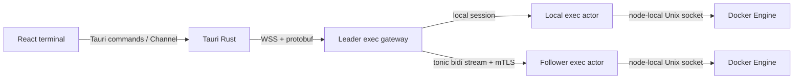

# Container exec in Kontainer v2

Status: proposed architecture and implementation plan

Research date: 2026-08-19

Primary target: Linux Docker Swarm

## Executive decision

Kontainer v2 should implement exec as a typed, cancellable Rust session that is owned by the agent running on the target Swarm node:



The leader authenticates, authorizes, resolves the current Swarm task placement, applies global limits, and either starts a local actor or proxies a typed bidirectional stream to the selected follower. Only the execution node talks to its node-local Docker socket. The desktop uses an authenticated native WebSocket and bridges bytes to React through a Tauri channel; the WebView never receives the agent JWT.

Use a Rust Docker client for version negotiation and ordinary create, resize, and inspect calls. Use a small, separately tested HTTP/1 upgrade adapter for the attached start stream. This boundary is intentional: the current Bollard `start_exec` implementation exposes a convenient split input/output interface, but its decoder guesses whether the upgraded stream is multiplexed from the first byte. A raw TTY stream may legitimately begin with `0x00`, `0x01`, or `0x02`, so that guess is not byte-transparent. The relevant behavior is visible in Bollard's [`start_exec` implementation](https://docs.rs/bollard/latest/src/bollard/exec.rs.html#225-279) and [`NewlineLogOutputDecoder`](https://github.com/fussybeaver/bollard/blob/master/src/read.rs). Upstreaming or adopting a raw upgraded-stream API is preferable to maintaining a fork; until one is available and contract-tested, the narrow adapter is the safe design.

The baseline deliberately does **not** promise transparent reconnection. Docker has no general “reattach to this running exec” endpoint. Retrying after start can create a second shell. A reconnect action therefore starts a clearly labelled new process. Resumable sessions are a later, execution-node-resident enhancement.

## Goals and non-goals

The v2 baseline must:

- Preserve the interactive v1 feature: open a TTY shell in a selected container replica, send arbitrary terminal bytes, resize it, and select a permitted user or shell.
- Work identically when the task is on the leader or a follower.
- Report the real exit result, route to the current task placement, preserve the selected user remotely, and enforce limits on the server.
- Keep terminal data byte-transparent and bounded under slow or malicious peers.
- Authenticate and authorize the entire session, including privileged user selection, and leave an audit trail without recording terminal content.
- Shut down deterministically without leaked tasks, permits, sockets, or misleading success messages.

The baseline is not a generic Docker API proxy, SSH replacement, arbitrary command runner, durable terminal multiplexer, or mechanism for killing processes inside containers. Docker exposes no kill/delete operation for an exec instance. Kontainer must not kill the container merely to clean up a shell.

## What v1 does today

The current path spans `server/app/services/docker/swarm/exec.go`, `server/app/services/websocket/exec_handler.go`, `server/app/services/websocket/exec_session.go`, `server/app/grpc/controllers/exec_controller.go`, the exec protobuf service, and `app/src/hooks/use-exec-stream.ts`.

| Area | Current behavior | Consequence for v2 |
| --- | --- | --- |
| Docker | Creates an always-TTY exec, attaches stdin/stdout/stderr, starts one shell, and wraps Docker's hijacked connection. Resize uses `context.Background()`. | Preserve interactive behavior, but bind every operation to session cancellation and implement framing explicitly. |
| Shell selection | Empty shell tries `/bin/sh`, `/bin/bash`, then `/bin/ash`; an explicit shell is tried first and silently falls back. Product copy instead promises bash → sh → ash and settings also offer zsh. | Make `auto` and explicit selection distinct and deterministic. Do not silently substitute an explicit request. |
| User selection | Local exec forwards `User`. The follower gRPC controller reads the protobuf field but does not pass it to Docker. | Remote and local execution must share one typed request and authorization path. |
| Exit status | Local sessions do not inspect the exec. The follower sends `EXIT 0` whenever Docker output ends. | Poll `ExecInspect` after EOF and never manufacture exit code zero. |
| Remote routing | The browser supplies `nodeID`; the leader looks up that node and forwards the request. | Resolve task → node → container server-side and revalidate it on the follower. Never accept a client-selected network address. |
| Public transport | The WebView opens a WebSocket directly to `/api/exec/{containerID}` and puts the long-lived JWT in the query string. Origin checking accepts every origin. Text frames carry resize JSON and binary frames carry bytes. | Move credentials and network transport into Tauri Rust; authenticate before upgrade, require a protocol version, and use typed binary messages. |
| Session lifecycle | Two relay goroutines stop when either side ends. Closing the attachment is treated as cleanup, and resize/inspect are not tied to the request. | One actor owns state; one cancellation token stops all children; cleanup performs a final bounded inspect and records possible orphaning. |
| Limits | The React page displays a maximum of ten sessions, but the server has no equivalent concurrency limit. Dimensions and message queues are effectively unbounded. | Enforce limits at leader and node; UI limits are only usability hints. |
| UI metadata | The connection bar hard-codes “Connected”, PID `--`, and TTY `pts/0`. Reconnect clears the terminal and starts a new exec. | Render server state. Docker can supply the host exec PID and TTY boolean, not a portable `pts/*` name. Label a reconnect as a new process. |
| Tests | The hook and small message helpers have frontend coverage, but the Docker hijack, framing, remote identity, routing, and real exit paths do not. | Add protocol, fake-daemon, real-Docker, cluster, security, and fault tests before parity is claimed. |

The v1 implementation is valuable as a behavior inventory, not as the v2 protocol contract. In particular, its mixed text/binary WebSocket protocol has no negotiation, sequence numbers, authoritative readiness metadata, or reliable distinction between a normal non-zero exit and a transport error.

## Parity and enhancement boundary

### Required for v1 parity

- Interactive TTY shell with stdin and terminal output.
- Local leader and remote follower execution.
- Shell auto-detection and explicit shell choice.
- Default-container user and permitted user override.
- Initial terminal size and subsequent resize.
- Multiple tabs/sessions, with a server-enforced limit.
- Explicit close and explicit “start a new session” reconnect.

Parity is not complete unless the v1 correctness gaps are also fixed: remote user propagation, real exit status, server-side target resolution, bounded input/output, authenticated routing, and deterministic cleanup are release gates rather than optional enhancements.

### V2 enhancements

- Non-TTY execution with distinct stdout and stderr.
- Authoritative PID, node, container, selected shell, effective user, and termination reason in the UI.
- One-time idempotency before an exec starts.
- Per-scope authorization and audit records.
- Structured error codes and retry guidance.
- Optional discovery of users from `/etc/passwd` without executing a command in the container.
- Later resumable sessions with a node-resident ring buffer and sequence acknowledgements.

Arbitrary argv, environment injection, working-directory overrides, privileged exec, durable sessions across agent restart, Windows containers, and a general node shell remain out of scope until separately designed and authorized.

## Session architecture

### Components

1. **Desktop exec manager.** A Tauri managed-state service owns the WSS connection and exposes narrow commands such as `open_exec`, `write_exec`, `resize_exec`, `close_stdin`, and `close_exec`. Rust-to-React output uses a per-session Tauri `Channel<ExecEvent>`; React-to-Rust input uses batched commands. Tauri documents channels as the ordered, high-throughput mechanism for streaming data, unlike global events ([Tauri Channels](https://v2.tauri.app/develop/calling-rust/#channels)). Keystrokes and paste should be batched for at most one animation frame or 16 KiB, whichever occurs first, instead of invoking once per byte.
2. **Leader exec gateway.** Authenticates before WebSocket upgrade, decodes `Open`, authorizes the principal and requested capabilities, resolves a current target, acquires global/per-principal/per-container permits, and delegates to an execution service. It never handles arbitrary Docker paths.
3. **Execution-node actor.** Owns the Docker exec ID, upgraded connection, stdin state, resize coalescer, output sequencing, deadlines, metrics, and final inspection. Local and remote calls use this same service.
4. **Follower RPC.** A tonic bidirectional stream carries the same semantic envelopes over mutually authenticated TLS. The follower validates a short-lived, leader-issued session grant and revalidates that the full container ID is local and belongs to the stated task.
5. **Docker adapter.** Performs version negotiation and control calls through the node-local Unix socket, plus a narrowly scoped raw HTTP/1 upgrade for start/attach.

### Ownership and state machine

Exactly one actor owns a session. Suggested states are:

```text
Accepted -> Resolving -> Creating -> Attaching -> Running -> Draining -> Finished
     \          \           \           \          \            \
      +--------------------------- Failed/Cancelled ----------------+
```

Only `Running` accepts input and resize. `CloseStdin` changes an independent `stdin_open` flag and does not end output. The first terminal condition—client close, policy revocation, timeout, upstream error, server shutdown, or observed process exit—cancels all relay tasks. Cleanup runs once under a fresh, short deadline even when the session token has already been cancelled.

Use a [`CancellationToken`](https://docs.rs/tokio-util/latest/tokio_util/sync/struct.CancellationToken.html) plus a `TaskTracker` or `JoinSet`; Tokio's shutdown guidance explicitly combines cancellation, waiting, and graceful task tracking ([Tokio graceful shutdown](https://tokio.rs/tokio/topics/shutdown)). Semaphore permits and audit completion guards should be RAII-owned by the actor so every path releases them.

## External terminal protocol

### Transport and authentication

The accepted transport is WSS from Tauri Rust to the leader with WebSocket subprotocol `kontainer.exec.v2`. A native client can send `Authorization: Bearer …`, eliminating the v1 query token. `tokio-tungstenite` supports a caller-built request and TLS configuration ([client connection API](https://docs.rs/tokio-tungstenite/latest/tokio_tungstenite/fn.connect_async_tls_with_config.html)). The server authenticates and authorizes basic exec access before returning `101 Switching Protocols`.

Requirements:

- WSS outside an explicitly configured loopback development mode.
- Fixed WebSocket path such as `/api/v2/exec`; target data belongs in the `Open` message, not the URL.
- Strict `Origin` allowlist when an `Origin` header is present. Native clients may omit it; omission is not a substitute for bearer authentication.
- A configured WebSocket maximum frame/message size, maximum write buffer, and compression disabled for opaque terminal bytes. Axum exposes all of these upgrade controls; its defaults are too generous for this protocol ([`WebSocketUpgrade`](https://docs.rs/axum/latest/axum/extract/struct.WebSocketUpgrade.html)).
- Standard WebSocket ping/pong for liveness and standard close frames. Do not add an application-level heartbeat unless it conveys state not represented by RFC 6455 ([RFC 6455](https://datatracker.ietf.org/doc/html/rfc6455)).
- Revalidate session expiry/revocation during long sessions and close promptly on logout. OWASP specifically calls out origin validation, message-level authorization, bounded messages, session expiry, and content-safe audit for WebSockets ([WebSocket Security Cheat Sheet](https://cheatsheetseries.owasp.org/cheatsheets/WebSocket_Security_Cheat_Sheet.html)).

If native transport cannot ship in the first increment, the only acceptable transition is an authenticated HTTPS endpoint that mints a single-use, audience-bound, target-bound ticket with a lifetime measured in seconds; the WebView may put that ticket, not the account JWT, in the WebSocket request. Continuing the long-lived JWT query parameter is rejected because URLs commonly appear in access logs, history, telemetry, and crash reports.

### Message model

Use length-bounded protobuf messages, one envelope per binary WebSocket message, and the same semantic messages over tonic. Protobuf is already the internal v1 precedent, preserves arbitrary bytes, has a compatibility model, and avoids JSON/base64 expansion. The public `.proto` is versioned separately from the agent HTTP API.

Client messages:

- `Open { protocol_version, request_id, target, tty, cols, rows, shell, user }`
- `Input { bytes }`
- `Resize { cols, rows }`
- `CloseStdin {}`
- `Close { reason }`

Server messages:

- `Ready { session_id, task_id, node_id, container_id, tty, pid?, selected_shell, effective_user? }`
- `Output { sequence, stream, bytes }`, where `stream` is `CONSOLE`, `STDOUT`, or `STDERR`
- `Metadata { … }` for later non-breaking state additions
- `Warning { code, safe_message }` for a recoverable condition such as an unsupported resize
- `Exit { exit_code?, reason }`
- `Error { code, safe_message, retryable }`

`Open` must be the first and only open message; one WebSocket represents one exec session. Input before `Ready`, duplicate open, resize for a non-TTY session, unknown required enum values, or messages after terminal state are protocol errors. Unknown protobuf fields remain ignorable for forward compatibility. The server assigns monotonically increasing output sequence numbers even before resumability exists; this makes ordering testable and reserves the contract for a future acknowledgement scheme.

The protocol carries bytes, not UTF-8 strings. It must neither normalize terminal data nor attempt to parse escape sequences. Docker's exit code is optional because transport/node loss may make it unknowable; “unknown” must not be encoded as zero.

Suggested WebSocket close codes are `1000` for a completed/explicitly closed session, `1008` for authentication, authorization, or protocol policy failures, `1009` for oversized messages, `1011` for an unexpected upstream/internal failure, and `1012` for agent restart. Send a safe typed `Error` when possible before closing; clients must still handle a close without one.

## Target resolution and remote routing

The primary target should be a stable Swarm object, not a browser-selected host:

```protobuf
message ExecTarget {
  oneof kind {
    SwarmTaskTarget task = 1;       // task_id + optional observed container ID
    LocalContainerTarget local = 2; // full container ID, separately authorized
  }
}
```

For a Swarm target the leader:

1. Inspects the task from the manager immediately before authorization/routing.
2. Requires a running task and reads `Task.NodeID` and `Task.Status.ContainerStatus.ContainerID` from that authoritative response. Docker's task schema exposes those fields ([Engine API task operations](https://docs.docker.com/reference/api/engine/version/v1.52/#tag/Task)); a Swarm task invokes exactly one container ([Swarm service model](https://docs.docker.com/engine/swarm/how-swarm-mode-works/services/)).
3. Resolves the node only through the authenticated discovery registry, including health and registration generation. The client never supplies an address.
4. Compares any observed container ID from the UI with the current full ID. A mismatch returns `stale_target` and refreshed non-sensitive metadata rather than silently opening a different replica.
5. Sends a target-bound session grant to the selected follower.

The follower independently verifies its node identity, inspects the full local container ID, requires it to be running, and verifies its association with the requested task. This defends against a stale or compromised leader-side registry entry and avoids container-name ambiguity. Swarm task states are one-way; a replacement task receives a different identity, so a stale task must be surfaced rather than guessed ([task lifecycle](https://docs.docker.com/engine/swarm/how-swarm-mode-works/swarm-task-states/)).

Internal RPC uses tonic bidirectional streaming with rustls mutual TLS, bounded encode/decode sizes, deadlines for setup/control operations, and normal HTTP/2 flow control. Tonic's transport supports TLS, concurrency, timeout, and rate-limit integration ([tonic transport](https://docs.rs/tonic/latest/tonic/transport/)); its default decode limit is 4 MiB while encoding is otherwise unbounded, so both directions require explicit smaller protocol limits ([tonic crate limits](https://docs.rs/tonic/latest/tonic/)). A static secret over plaintext, as used in v1, is rejected. Certificates authenticate agents; a short-lived signed grant carries principal ID, granted capabilities, target task/container/node, session/request IDs, expiry, and nonce so the follower does not lose end-user identity.

## Docker exec sequence

Docker Engine's current API reference is versioned and clients should negotiate the daemon's supported API rather than assume the newest endpoint ([Engine API overview](https://docs.docker.com/reference/api/engine/)). API version prefixes are required for stable behavior; response schemas are open, so new response fields must be ignored ([versioned Engine API](https://docs.docker.com/reference/api/engine/version/v1.52/)). The official Exec operations cover create, start, resize, and inspect ([Engine API Exec tag](https://docs.docker.com/reference/api/engine/version/v1.52/#tag/Exec)); Moby's current client source shows those operations as one lifecycle ([`container_exec.go`](https://github.com/moby/moby/blob/master/client/container_exec.go)).

The execution actor performs:

1. **Create** — `POST /containers/{full-id}/exec` with `AttachStdin`, `AttachStdout`, and `AttachStderr` true; `Tty` set from the request; `Cmd` as an argv array; optional validated `User`; `Privileged: false`; and `ConsoleSize: [rows, cols]` for a TTY. Do not expose `Privileged`, `Env`, or `WorkingDir` in the parity request. The API accepts user/name and user/group ID forms and defines console size as `[height, width]` ([`CreateExecOptions`](https://docs.rs/bollard/latest/bollard/exec/struct.CreateExecOptions.html), [`ExecConfig`](https://docs.rs/bollard/latest/bollard/models/struct.ExecConfig.html)).
2. **Start attached** — `POST /exec/{id}/start` with `Detach: false`, exactly the same `Tty` value, and the console size. Send HTTP/1 headers `Connection: Upgrade` and `Upgrade: tcp`; require a valid upgrade response and retain bytes that the HTTP parser has already buffered. Moby's current client demonstrates this handshake and buffered-reader handoff and enables TCP keepalive where applicable ([Moby hijack client](https://github.com/moby/moby/blob/master/client/hijack.go)). Node-local Unix sockets remain the production default.
3. **Resize** — after the upgrade, issue `POST /exec/{id}/resize?h={rows}&w={cols}` for TTY sessions, then service coalesced resize messages. Resize is invalid for non-TTY sessions. An initial resize closes daemon/version races even when console size was supplied during create/start. Unsupported resize may become a typed warning; container disappearance is terminal. Do not ignore every error.
4. **Inspect readiness** — `GET /exec/{id}/json` obtains `Running`, `Pid`, `ExitCode`, process config, and container ID. If a very short process has already exited, send an ordered `Ready` with absent PID followed by its real `Exit` rather than reporting attach failure.
5. **Relay** — one task reads Docker output, one serializes stdin writes, and one coalesces resize requests. Bounded channels and cancellation connect them to the actor.
6. **Inspect completion** — Docker stream EOF means only that no more attachment bytes are available. Poll inspect under a short bounded grace period until `Running` is false, then emit its actual `ExitCode`. A non-zero code is a normal `Exit`, not a transport error. If the daemon cannot provide a result, emit an unknown exit code with a precise termination reason; never synthesize zero.
7. **Cleanup** — half-close stdin when appropriate, briefly drain output, close the upgraded connection, perform one final inspect using an independent cleanup timeout, release permits, and finish audit/metrics exactly once.

Docker documents that an exec command must be an executable argv entry and runs only while the container's PID 1 is running; a quoted/chained shell expression is not implicitly interpreted ([`docker container exec`](https://docs.docker.com/reference/cli/docker/container/exec/)). The implementation must mirror that model instead of constructing command strings.

### HTTP upgrade implementation boundary

The raw adapter is deliberately small:

- Only `POST /exec/{validated-id}/start` is supported.
- The path uses a fully validated daemon-generated exec ID and a negotiated numeric API version; no caller-supplied path or host is accepted.
- It serializes a fixed JSON start body, enforces response-header and error-body limits, accepts the modern `101` upgrade contract, and hands back an `AsyncRead + AsyncWrite` stream plus response metadata.
- It preserves every byte read beyond the HTTP headers.
- It is tested over a Unix-domain socket with adversarial fragmentation and coalescing.

Hyper's upgraded connection implements asynchronous read/write and shutdown ([`hyper::upgrade::Upgraded`](https://docs.rs/hyper/latest/hyper/upgrade/struct.Upgraded.html)); `hyperlocal` supplies Unix-domain-socket connectors ([hyperlocal](https://docs.rs/hyperlocal/latest/hyperlocal/)). Adding either dependency requires the repository's normal dependency approval. Supporting an older `200` hijack response is an explicit compatibility decision; Moby's current upgrade client requires `101`, so v2 should initially set a minimum supported Engine version and reject an ambiguous response rather than guess.

### TTY and non-TTY stream framing

Docker's two output modes are different wire protocols:

- **TTY:** one raw byte stream with stdout and stderr merged. No Docker headers may be stripped. The protocol publishes `Output(CONSOLE, bytes)`.
- **Non-TTY:** Docker multiplexes stdout and stderr. Each frame has an 8-byte header: stream type in byte 0 (`0` stdin, `1` stdout, `2` stderr, `3` system error), three reserved bytes, and a big-endian unsigned 32-bit payload length. Moby's `stdcopy` implementation is the primary definition ([source](https://github.com/moby/moby/blob/master/api/pkg/stdcopy/stdcopy.go), [package contract](https://pkg.go.dev/github.com/moby/moby/api/pkg/stdcopy)). Decode incrementally across arbitrary reads and publish `STDOUT` and `STDERR` separately.

Moby's exec client explicitly documents the same split: TTY output is a single raw stream, while non-TTY stdout/stderr is multiplexed ([Moby exec client](https://github.com/moby/moby/blob/master/client/container_exec.go)). The actor knows `Tty` from the accepted request and must use it as the authoritative framing choice. Content-Type may be checked for consistency but must not trigger a byte heuristic. The non-TTY decoder validates stream type and reserved bytes, imposes a maximum frame payload, streams large allowed payloads in bounded chunks, detects truncation at EOF, and never allocates directly from an unchecked 32-bit length. Input to Docker is unframed in both modes.

Tests must include raw TTY data whose first byte is `0`, `1`, or `2`; fragmented headers; multiple frames in one read; zero-length frames; binary payloads; invalid types; oversized lengths; and EOF in both header and payload. This is the acceptance test that prevents the current Bollard decoding ambiguity from entering v2.

## Stdin, resize, cancellation, and backpressure

Input messages are ordered through one bounded queue and written with `write_all`; partial writes are not data loss. `CloseStdin` is idempotent and maps to an async write shutdown/half-close when supported. Output continues until process exit or another terminal condition. Ctrl-D received as terminal input remains an ordinary byte; it is not silently converted into protocol-level EOF. Input after `CloseStdin` receives `stdin_closed` and is not written.

On client disconnect, policy revocation, or timeout:

1. Stop accepting new input and resize.
2. Cancel relays and attempt a bounded stdin half-close.
3. Drain output only for a short configured interval.
4. Close the attachment and perform final inspect.
5. Record whether the process exited or may still be running.

Do not inject `exit`, Ctrl-C, or Ctrl-D, because each changes application semantics. Docker does not expose a general signal/kill/delete endpoint for an exec instance. Closing the attachment may cause a particular shell to terminate, but that is not guaranteed. If final inspect still reports `Running`, finish the client session with `abandoned_process_possible`, increment an orphan metric, and retain only the internal Docker exec ID in protected diagnostic state. Killing the whole container is never automatic.

Use bounded Tokio MPSC queues; bounded channels provide backpressure rather than unbounded memory growth ([Tokio `mpsc`](https://docs.rs/tokio/latest/tokio/sync/mpsc/)). When a client cannot consume output, pause reading Docker naturally for a short grace period. This may backpressure the process, which is more honest than silently dropping terminal bytes. If the queue remains full beyond the configured slow-consumer deadline, terminate the attachment with `slow_consumer`, audit it, and report that the process exit may be unknown. Never reorder, truncate, or discard output while claiming a healthy session.

Resize is latest-value state, not a lossless event log. Coalesce bursts, apply at most the configured rate, and ensure the final size is eventually sent. Input is lossless and must never share a “drop-oldest” queue with resize.

## Shell and user selection

### Shell selection

Model shell selection as either `Auto` or `Explicit(path)`:

- `Explicit` is strict. Try exactly the validated path and report `shell_not_found`, `shell_not_executable`, or a safe Docker error. Silent fallback would violate user intent and can change security/profile behavior.
- `Auto` uses a server-owned, deterministic candidate list. Proposed order: the selected user's login shell from bounded `/etc/passwd` discovery when available, then configured image/container hints, then `/bin/bash`, `/bin/sh`, `/bin/ash`, `/bin/zsh` with duplicates removed. The parity order must be agreed because current code starts with `sh` while product copy promises `bash` first.
- Candidates are exact argv elements, never interpolated into `sh -c`. By default require an absolute allowlisted path, maximum 256 bytes, valid UTF-8 for metadata, and no NUL/control characters. A separately authorized `exec.shell.custom` capability may broaden the allowlist without allowing arguments.
- Retry another auto candidate only for a classified pre-`Ready` shell/user executable failure. Bound attempts. Docker has no exec-delete endpoint, so every failed create remains daemon metadata until Docker cleans it up.

Container `Config.Shell` is primarily the shell used for Dockerfile shell-form instructions, not proof that an interactive executable exists. Treat it and a `SHELL` environment value as hints only. The start result remains authoritative.

### User selection and discovery

An empty user means the container-configured default. An override accepts only Docker's documented forms: `user`, `user:group`, numeric `uid`, or numeric `uid:gid`; enforce a 128-byte maximum, a conservative name/number grammar, no whitespace/control/NUL, and no command interpretation. Forward the same validated value through local and remote paths.

Suggested capabilities are:

- `exec.open`
- `exec.user.override`
- `exec.user.root`
- `exec.shell.custom`
- `exec.non_tty`

Requests resolving to UID 0 require `exec.user.root`. If policy forbids root and a named user cannot be resolved safely, fail closed. Whether the container's default user may be root without an explicit root grant is an open product-policy decision and must be consistent for local and remote sessions.

For the user picker, read `/etc/passwd` through Docker's bounded archive endpoint rather than executing `cat`; the Engine API exposes container archive retrieval ([container archive API](https://docs.docker.com/reference/api/engine/version/v1.52/#tag/Container/operation/ContainerArchive)). Accept at most one regular file, cap compressed and expanded data (proposed 1 MiB), reject links/devices/path traversal, parse only required fields, and cache briefly by immutable container/image identity. Discovery is advisory: a container may lack `/etc/passwd`, use NSS, or change after lookup. It must not block choosing the default user.

## Authorization, audit, and Docker-socket security

JWT validation must pin allowed algorithms and require appropriate `exp`, `sub`, `iss`, and `aud` claims; the Rust `jsonwebtoken` validation model exposes these checks ([`Validation`](https://docs.rs/jsonwebtoken/latest/jsonwebtoken/struct.Validation.html)). Authenticate before resolving a target to avoid unauthenticated inventory disclosure. Authorize after authoritative resolution against environment/stack/service/task/node scope and again for user, root, custom shell, or non-TTY capabilities. Followers enforce the signed grant rather than trusting unconstrained fields from the leader.

Record structured audit events for request, ready, and completion with:

- correlation/request/session ID (never a bearer or resume token);
- principal, role/policy decision, and granted privileged capabilities;
- environment, stack/service/task, full container ID in the protected sink, and node;
- requested and effective shell/user, TTY mode and dimensions;
- local/remote route, start/end timestamps, PID when known, bytes in/out, exit code when known, and termination/error code.

Never record terminal input/output, authorization headers, query strings containing credentials, session grants, raw Docker error bodies, or full WebSocket URLs. Sanitize user-controlled values against log injection. Map Docker errors to stable safe messages while retaining restricted correlation details for operators.

Access to the Docker daemon is effectively root-equivalent on a typical host. Docker's security documentation warns that daemon control can grant host-level privilege ([Docker daemon security](https://docs.docker.com/engine/security/), [protecting daemon access](https://docs.docker.com/engine/security/protect-access/)). Therefore:

- Connect only to the node-local Unix socket (or a separately approved rootless/sandboxed endpoint).
- Never expose a generic Docker URL/path/body through public or internal APIs.
- Never accept a client-selected daemon/follower address.
- Keep the follower's OS/socket permissions minimal and isolate its credentials.
- Do not enable remote Docker TCP merely for exec. If a future deployment requires it, mutual TLS and host allowlisting are mandatory.

## Validation and operational limits

The following are proposed initial defaults, all server-configured and observable. They require load testing before being frozen as product defaults.

| Limit | Proposed default | Behavior |
| --- | ---: | --- |
| Open/control message | 8 KiB | Close `1009` if exceeded. |
| Input message | 64 KiB | Reject before allocation/write. Desktop batches below this. |
| Docker mux frame | 16 MiB | Decode in smaller chunks; larger header is upstream protocol failure. |
| Per-session inbound queue | 64 KiB | Backpressure the client; rate-limit sustained input. |
| Per-session outbound queue | 256 KiB | Backpressure Docker, then slow-consumer timeout. |
| Dimensions | columns 2–500; rows 2–300 | Reject an invalid open or resize. |
| Resize rate | 10 applied updates/second | Coalesce to latest dimensions. |
| Input rate | 1 MiB/second with bounded burst | Policy-close persistent flood. |
| Concurrent sessions | global 100; per principal 10; per container 5 | Acquire before Docker create; node also enforces a local safety cap. |
| Open/handshake | 5 seconds | Includes first protocol message, not user session lifetime. |
| Task routing/follower dial | 3 seconds each | Return retryable routing error. |
| Docker create / attach | 5 / 10 seconds | Cancel and inspect on ambiguity. |
| Resize / inspect | 2 seconds each | Resize can warn; completion inspect gets a bounded retry grace. |
| Slow consumer | 5 seconds continuously full | Close without pretending output was delivered. |
| Idle / maximum duration | 30 minutes / 8 hours | Application I/O, not ping frames, resets idle. |
| Heartbeat | ping every 20 seconds; pong within 10 | Transport liveness only. |

Task, node, container, request, and session identifiers get exact type/length/character validation. Prefer full daemon container IDs; do not accept names where collisions or stale reuse are possible. Shell and user bounds apply before protobuf-to-Docker conversion. Protobuf recursion/message limits and WebSocket frame/message limits must agree so an outer transport cannot admit data the inner layer cannot safely process.

Do not put a blanket Tower request timeout around the upgraded session: it would terminate healthy long-lived shells. Apply phase-specific deadlines inside the actor. Tower concurrency/load-shed layers remain useful for the short upgrade and admission path ([`ServiceBuilder`](https://docs.rs/tower/latest/tower/builder/struct.ServiceBuilder.html)).

## Reconnection and idempotency

Before Docker start succeeds, `request_id` may be registered in a short-lived idempotency map. A duplicate `Open` from the same principal and target receives the same pending result or a typed conflict, avoiding two exec creates during a lost handshake.

After `Ready`, automatic retry is unsafe: the Docker API has start, resize, and inspect endpoints but no general endpoint that reattaches a new connection to an arbitrary running exec. The v2 baseline therefore:

- treats transport loss as session loss;
- performs the cleanup/final-inspect sequence;
- retains the transcript in the UI with a visible “connection ended” divider;
- offers “Start new shell,” which obtains a new session and process;
- never calls that action “reconnect” without qualification.

A later resumability issue may keep the actor and Docker attachment alive on the execution node for a short grace period. It would require a bounded output ring, output sequence/ack messages, a single-use signed resume token bound to principal/session/node, clear overflow behavior, and resource permits held throughout the grace. It can survive a leader or desktop network interruption only while that actor remains alive; it cannot truthfully promise survival of follower restart, Docker restart, container replacement, or buffer overflow. This enhancement must not delay parity.

## Alternatives considered

| Decision | Accepted | Rejected or deferred | Rationale |
| --- | --- | --- | --- |
| Docker library boundary | Bollard (or equivalent pure-Rust client) for negotiation/control plus a tiny raw HTTP/1 attach adapter. Revisit when a byte-transparent public raw stream exists. | High-level `start_exec` as-is; a full custom Docker SDK; shelling out to Docker CLI. | Control models are useful, but attached TTY bytes cannot be guessed. A full SDK duplicates too much; a CLI subprocess complicates credentials, lifecycle, framing, and errors. |
| Public transport | Native Tauri WSS with bearer header and protobuf; Tauri Channel to React. | Direct WebView socket with JWT query; SSE; raw TCP/SSH. One-time WebView ticket is transitional only. | Native transport protects credentials and is bidirectional. SSE is output-only. Raw TCP/SSH creates a new exposed protocol/auth surface. |
| Internal transport | tonic bidirectional gRPC with mTLS and target-bound grants. | v1 plaintext shared secret; client-to-follower; leader-to-remote Docker daemon. Message broker deferred. | Maintains one public gateway and node-local Docker ownership while preserving identity and flow control. A broker adds operational/state complexity without parity value. |
| Terminal protocol | Versioned protobuf envelopes with opaque byte fields and explicit streams. | v1 binary-input/text-control JSON; JSON/base64; separate input/output sockets. | One schema supports compatibility, error contracts, and binary data without expansion or cross-socket ordering races. |
| Target | Server-resolved Swarm task, plus separately gated full local container ID. | Client-supplied node/address or ambiguous container name. | Prevents stale placement, SSRF-style routing, and wrong-replica exec. |
| Session placement | Actor on the node holding the Docker connection; leader is a semantic proxy. | Leader-owned remote Docker attachment. | Contains Docker privilege and makes cleanup/flow control local to the process. |
| Reconnection | Baseline creates a visibly new process; pre-start idempotency only. | Blind automatic reopen. Durable resume deferred. | Blind reopen can duplicate a shell. Honest resume requires retained actor state and bounded replay. |
| Shell fallback | Deterministic fallback for `Auto`; strict explicit path. | Silent fallback from an explicit path; `sh -c` string construction. | Preserves intent and prevents argument injection/quoting ambiguity. |
| Disconnect cleanup | Half-close, bounded drain, close attachment, final inspect, audit possible orphan. | Injecting terminal commands or killing the container. | Docker has no exec kill API, and injected bytes alter application semantics. |
| Container attach WebSocket | None. | `/containers/{id}/attach/ws`. | It attaches to the container's primary process; it does not create/manage a Docker exec process. |
| WebTransport/QUIC | None for parity. | Deferred. | Adds proxy, certificate, browser/native, and observability complexity without solving Docker-side reattach. |

## Failure contract

Stable error codes should be documented and mapped consistently through follower, leader, desktop, and UI. Messages are safe for users; restricted logs retain correlated causes.

| Failure | Expected result |
| --- | --- |
| Missing/invalid/expired token at handshake | HTTP `401`; no upgrade and no target lookup. |
| Authenticated but exec/root/custom-shell scope denied | HTTP `403` before upgrade when possible, otherwise `Error(permission_denied)` + `1008`; no Docker create. |
| Malformed/oversized/out-of-order protocol | `invalid_request` or `protocol_violation`, then `1008`/`1009`; audit metadata only. |
| Stale task/container observation | `stale_target`, non-retryable without UI refresh; do not silently select another replica. |
| Task not running or container replaced | `target_not_running` / `target_replaced`; no fallback to a name. |
| Registry node unavailable or follower dial timeout | `node_unavailable`, retryable before start. |
| Follower identity/grant mismatch | `route_auth_failed`, non-retryable and security alert. |
| Docker daemon unavailable | `docker_unavailable`, retryable only before confirmed start. |
| Create fails | Classified safe Docker error; release all permits. |
| Upgrade fails before `101` | `exec_start_failed`; inspect because request delivery may be ambiguous. Do not retry automatically after possible start. |
| Shell/user missing or not executable/permitted | Strict explicit request fails. Auto shell tries only the next bounded classified candidate. |
| Container paused/stopped/restarting during open | `target_not_runnable` with refreshed status. |
| Process exits 0 or non-zero | `Exit` with inspected code; both are clean protocol completion. |
| Docker output EOF while inspect says running | Bounded poll/drain; if unresolved, `Exit` with unknown code and `upstream_detached`. |
| Docker frame malformed/truncated/oversized | `docker_protocol_error`, `1011`, no partial success claim. |
| Resize fails | Typed warning if session remains valid; terminal target/upstream error if the container/exec disappeared. |
| Client closes stdin | Keep reading output and eventually inspect exit. |
| Client/WebSocket disappears | Cancel, half-close/drain, final inspect, audit `client_disconnected`; do not reopen automatically. |
| Output client remains slow | Backpressure for grace, then `slow_consumer`; audit possible orphan. |
| Follower/leader link fails after start | Execution node cleans up on stream cancellation/lease expiry; exit may be unknown to client. |
| Token expires, logout, or access revoked | Cancel active session with `session_revoked`; do not wait for idle timeout. |
| Graceful agent shutdown | Stop admissions, send `server_restart`, cancel/drain actors within shutdown budget, then close `1012`. |
| Docker/container/agent restarts | No false resume or exit zero; return explicit upstream/session-loss reason. |

## Testing strategy

### Unit and property tests

- Validators for target IDs, dimensions, user forms, shell paths, message sizes, and capability combinations.
- Session-state transition tests, including duplicate/out-of-order messages, cancellation at every state, and exactly-once cleanup/audit.
- Property and fuzz tests for the non-TTY frame decoder: fragmented/coalesced input, leading bytes `0/1/2` in raw TTY mode, zero/huge lengths, invalid stream/reserved bytes, binary data, and truncated EOF.
- Bounded queue, resize coalescing, input ordering/partial-write, `CloseStdin`, slow-consumer, permit, timeout, and sequence-number tests with paused Tokio time where useful.
- Error sanitization and audit redaction tests that search captured logs for input bytes, bearer/session tokens, raw URLs, and Docker bodies.

### Fake Docker daemon tests

Run an HTTP/1 fake over a Unix-domain socket and assert exact versioned paths, JSON, `Tty` consistency, `[rows, cols]` ordering, upgrade headers, and control-call sequence. Test:

- `101` with stream bytes in the same kernel read as headers;
- every header/body boundary fragmentation;
- partial reads/writes and stdin half-close;
- bounded 4xx/5xx JSON and non-JSON error bodies;
- upgrade timeout or disconnect after request delivery;
- raw TTY and multiplexed non-TTY streams;
- inspect transitions from running to `exit 0`, `exit 42`, and unavailable;
- resize success, unsupported response, and disappearing exec.

### Real Docker integration tests

On Linux CI with a pinned minimum and current supported Engine, cover Alpine/bashless and bash images, a no-shell/distroless image, non-root and root users, missing user/shell, binary/control-byte output, TTY raw mode, non-TTY stdout/stderr separation, `stty size` after resize, explicit stdin EOF, `exit 0`, `exit 42`, and high-volume input/output. Exercise stopped, paused, restarted, and removed containers. Assert that closing a connection never leads the API to report an invented exit code.

### Cluster and security tests

- Leader-local and follower-remote sessions use the same behavior and preserve user/shell/TTY fields.
- Fresh task placement, rolling-update stale IDs, rescheduling, unhealthy registry entries, follower loss, and leader-follower network partitions.
- mTLS identity, expired/replayed/wrong-target grants, forged node/address fields, and follower local-container association.
- Missing/expired/wrong-audience/wrong-algorithm JWT, disallowed origin, logout/revocation, scope denial, root escalation, custom shell denial, frame/message floods, and concurrent-limit races.
- Verify gRPC and WebSocket flow control with a zero-speed reader and ensure memory remains bounded.

### Desktop and UI tests

- Tauri command/channel contract and Rust/TypeScript camelCase serialization.
- Byte ordering, binary data, paste batching, resize coalescing, stdin close, channel teardown, and no duplicate open on component remount.
- Status/PID/TTY/user/node values come from `Ready`; no hard-coded connection state or `pts/0`.
- A lost connection retains output, displays the terminal reason, and labels the next action as a new process.
- Existing multi-session behavior plus server rejection when limits race or differ from UI hints.

### Soak and fault tests

Run many concurrent sessions with huge paste/output, slow and abandoned clients, daemon restarts, container removal, follower/leader restart, and network partitions. Acceptance requires stable memory/file-descriptor/task counts; all semaphore permits released; bounded shutdown; no session grants or terminal data in logs; and metrics reconciling opened sessions with completed/abandoned outcomes.

## Implementation and acceptance checklist

### Protocol and domain

- [ ] Define versioned external/internal protobuf envelopes, stable error codes, close semantics, byte/size bounds, and compatibility tests.
- [ ] Define `ExecTarget`, `Auto` versus `Explicit` shell selection, optional user, TTY/non-TTY, dimensions, and capability checks as domain types.
- [ ] Implement the single-owner actor/state machine, cancellation tree, bounded queues, RAII limits, and exactly-once audit completion.
- [ ] Prove with tests that exit zero is never inferred from EOF and unknown remains representable.

### Docker adapter

- [ ] Negotiate and pin a supported Engine API range; reject unsupported daemons with a clear diagnostic.
- [ ] Implement create, raw start/upgrade, resize, and inspect with phase deadlines and safe error mapping.
- [ ] Preserve buffered post-upgrade bytes and support stdin half-close.
- [ ] Implement authoritative TTY raw relay and bounded incremental non-TTY demultiplexing.
- [ ] Set `Privileged: false`; do not expose env/workdir/arbitrary argv in the parity API.
- [ ] Complete fake-daemon and real-Docker suites, including TTY streams beginning with `0x00`, `0x01`, and `0x02`.

### Routing and security

- [ ] Resolve task placement and full container ID on the leader for every open; fail safely on stale observations.
- [ ] Revalidate node/container/task association on the execution node.
- [ ] Replace insecure shared-secret gRPC with mTLS and short-lived scoped grants, including issuance, rotation, expiry, and replay handling.
- [ ] Enforce RBAC for open/user/root/custom-shell/non-TTY and test the same policy locally and remotely.
- [ ] Configure WebSocket origin, TLS, protocol, compression, frame/message/write-buffer, heartbeat, and auth-expiry behavior.
- [ ] Add structured content-free audit and metrics with redaction tests.

### Desktop and product

- [ ] Move agent WebSocket ownership and bearer use into Tauri Rust; expose narrow commands and a per-session output channel.
- [ ] Batch input, coalesce resize, propagate close-stdin, and clean managed state on every terminal path.
- [ ] Render `Ready`, `Exit`, and typed errors instead of hard-coded connected/PID/TTY values.
- [ ] Reconcile shell fallback order and user/root policy with product settings and copy.
- [ ] Preserve transcript on loss and describe a subsequent attempt as “Start new shell.”
- [ ] Keep UI session limits as hints while testing authoritative server limits.

### Release gates

- [ ] Local and remote acceptance scenarios are behaviorally identical, including selected user and non-zero exit.
- [ ] Target routing cannot be influenced by a client-supplied address or stale node value.
- [ ] Memory, tasks, file descriptors, and permits remain bounded under flood, slow consumer, cancellation, and soak tests.
- [ ] No terminal content or credential appears in application, proxy, audit, telemetry, or crash logs.
- [ ] Agent and desktop shutdown terminate or classify every active session within their budgets.
- [ ] Supported Docker versions, timeouts, limits, error codes, and the no-durable-reconnect guarantee are documented for operators/users.

## Open decisions suitable for GitHub issues

1. **Minimum Docker Engine/API version.** Choose the supported range and decide whether a legacy `200` hijack response is required or modern `101` is the only accepted start contract.
2. **Raw attach ownership.** Upstream a byte-transparent Bollard API, use a released upstream facility when available, or approve the narrow Hyper/hyperlocal adapter and its maintenance/testing boundary.
3. **Initial desktop cutover.** Ship native Tauri WSS immediately or temporarily use single-use WebView tickets. The long-lived JWT query path is not an option.
4. **Exec authorization policy.** Define service/stack/environment/node scope, whether a root-configured container default requires `exec.user.root`, and who may choose named/numeric users or custom shells.
5. **Parity shell order.** Resolve the v1 code (`sh`, `bash`, `ash`), current product copy (`bash`, `sh`, `ash`), zsh setting, and login-shell hint into one tested order.
6. **Command surface.** Decide whether v2 exposes only interactive shells initially or also a separately authorized arbitrary-argv/non-TTY API. Never overload a shell string as a command.
7. **Operational defaults.** Benchmark and finalize queue sizes, message/frame bounds, admission limits, input/resize rates, phase deadlines, idle duration, maximum session duration, heartbeat, and slow-consumer grace.
8. **Orphan policy.** Define operator visibility, metrics, retention of protected exec diagnostics, and optional future supervisor design for a process that remains running after attachment loss. Do not solve this by killing its container.
9. **Resumable session enhancement.** Specify actor lease, replay buffer, sequence/ack protocol, token rotation, grace period, overflow, failover limits, and held-resource accounting.
10. **User discovery.** Decide whether bounded `/etc/passwd` archive reading is enabled, how its data is authorized/cached, and how NSS/minimal-image limitations appear in the UI.
11. **Agent certificate lifecycle.** Select CA ownership, provisioning, node-identity binding, rotation, revocation, and behavior during certificate expiry/partition.
12. **Audit destination and retention.** Define sink guarantees, access controls, redaction schema, retention, and correlation with broader Kontainer security events.
13. **PID and TTY presentation.** Confirm that PID means Docker's host-side exec PID and TTY means a boolean/mode. Do not promise a `pts/*` device name that Docker inspect does not expose.
14. **Unknown exit semantics.** Finalize UI/API distinctions among normal exit, non-zero exit, transport loss with a still-running exec, and permanently unknowable status.
15. **Windows containers.** Explicitly defer or design named-pipe transport, shell defaults, user syntax, terminal semantics, and CI; the architecture above targets Linux Swarm.
16. **Protocol evolution.** Choose package/version naming, supported client/server skew, unknown-field policy, and the deprecation window for the v1 WebSocket/gRPC messages.

## Definition of done

V2 exec is done when an authorized user can open a shell on any current Swarm task through the desktop, receive byte-exact TTY output, resize and close stdin, see authoritative node/container/PID/mode metadata, and receive the inspected exit result; the same tests pass through a local leader and an mTLS follower. A stale target cannot open the wrong replica, a remote request cannot drop the selected user, a slow or malicious peer cannot create unbounded memory/tasks/sessions, and every terminal path produces one redacted audit outcome and releases its resources. Reopening after loss is explicitly a new process until the separate resumability design is implemented.
